# Week 6: Energy-based models

All required exercises in Parts 1-4 are implemented on CPU. **All 15 result figures are embedded in this README**, beside their producing commands and interpretation. Downloads, trained weights, generated arrays, and individual trial records remain in the ignored `inputs/` and `artifacts/` folders. Only source, the locked environment, compact numerical evidence, and figures are committed.

## Reproduce the experiments

Install [uv](https://docs.astral.sh/uv/), then run from `week6/`:

```bash
bash scripts/reproduce.sh
```

The script installs the exact environment from `uv.lock`, downloads or reuses the original datasets, runs independent model checks, trains both full-size RBMs, evaluates generation and completion, performs the full Hopfield sweep, renders every figure, and runs the acceptance checks. Python 3.14.4, JAX 0.11.2, NumPy 2.5.3, and SciPy 1.18.1 were used on WSL CPU. No GPU or pretrained image model is needed for this week's required work. The plotting helpers use `interpolation="nearest"`; displayed pixels are the original arrays.

Useful individual commands, all run from this directory:

```bash
uv run python scripts/datasets.py
uv run python scripts/check_contracts.py
uv run python scripts/rbm.py
uv run python scripts/hopfield.py --part random
uv run python scripts/hopfield.py --part modern
uv run python scripts/plot_results.py
uv run python scripts/verify.py
```

`rbm.py --sample-only` reuses locally saved trained parameters for sampling. `hopfield.py --part random --n 800` reruns just one network size. The complete reproduction run used the normal allocation of 20 CPU threads. Runtime includes compilation on first use and is machine-dependent.

## Part 1: Dataset representation and empirical distributions

**Producer:** `uv run python scripts/datasets.py`.

| Dataset | Training records | Test records | One image | Stored pixels |
|---|---:|---:|---|---|
| MNIST | 60,000 | 10,000 | 28×28 grayscale | uint8, 0-255 |
| CIFAR-10 | 50,000 | 10,000 | 32×32×3 RGB | uint8, 0-255 |

Images retain their original split and stored order. MNIST image and label files are read in matching order. CIFAR binary records contain one class label followed by red, green, and blue planes; the reader converts these into RGB images without changing their labels.

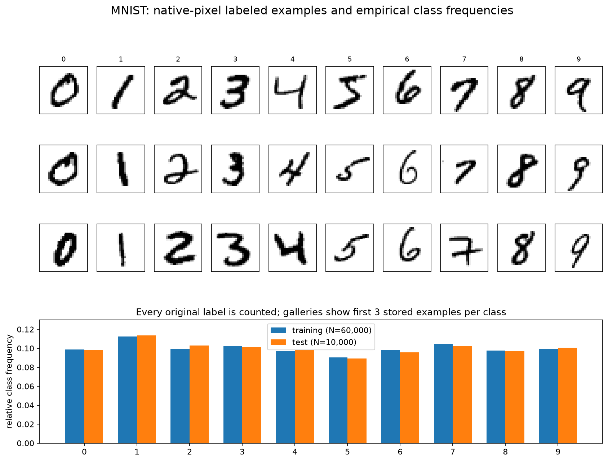

Different examples of the same digit show different stroke thickness, slant, and shape. Digit **1 is most common and 5 least common in both splits**. The three-example-per-class gallery balances appearances for inspection; it does not measure frequency. The lower plot counts every label separately in each original split.

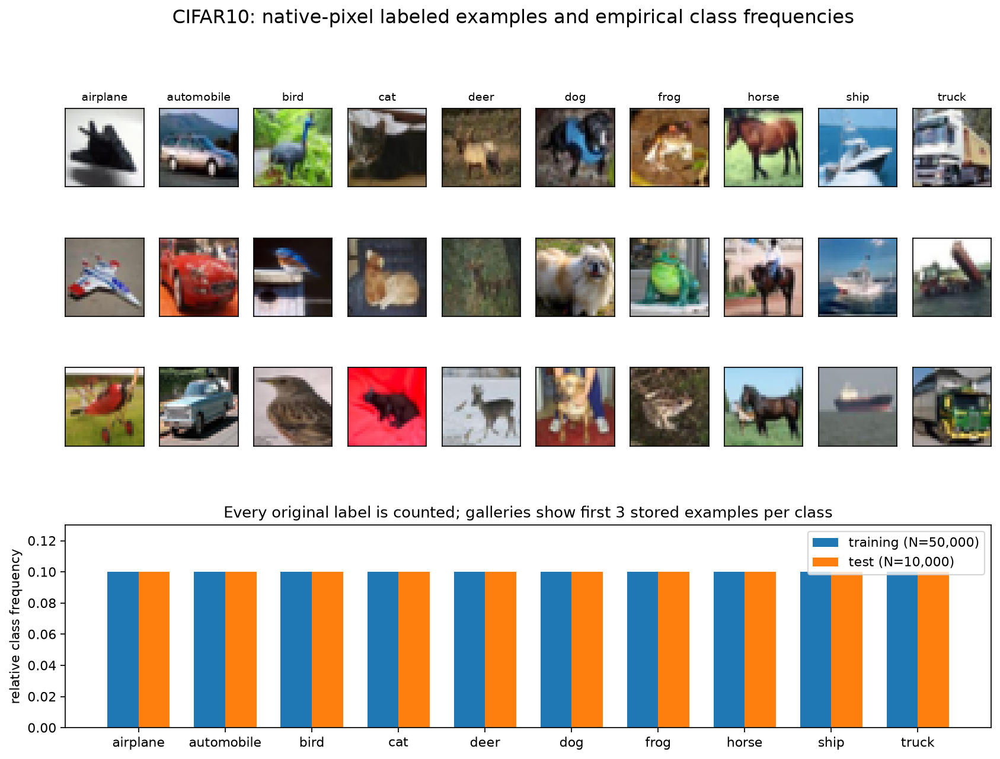

CIFAR-10 has exactly 5,000 training and 1,000 test records per class, so every class fraction is 0.1. Coarse object shapes and colors remain visible at 32×32, while fine features and background details are often ambiguous. The gallery describes image content; the frequency plot describes the empirical class distribution.

### Dataset provenance

These are the exact learning-sheet download URLs. SHA-256 hashes and file sizes are retained in `evidence/dataset-provenance.json`; split counts are in `evidence/dataset-counts.json`.

- [MNIST training images](https://storage.googleapis.com/cvdf-datasets/mnist/train-images-idx3-ubyte.gz)
- [MNIST training labels](https://storage.googleapis.com/cvdf-datasets/mnist/train-labels-idx1-ubyte.gz)
- [MNIST test images](https://storage.googleapis.com/cvdf-datasets/mnist/t10k-images-idx3-ubyte.gz)
- [MNIST test labels](https://storage.googleapis.com/cvdf-datasets/mnist/t10k-labels-idx1-ubyte.gz)
- [CIFAR-10 binary archive, learning-sheet mirror](https://mindspore-website.obs.cn-north-4.myhuaweicloud.com/notebook/datasets/cifar-10-binary.tar.gz)

MNIST is read from the CVDF mirror. The CIFAR-10 dataset is described by its [authors' dataset page](https://cave.cs.toronto.edu/kriz/cifar.html); the download above is the mirror specified by the course.

## Part 2: Learn a generative spin model of digits

**Model and experiment producer:** `uv run python scripts/rbm.py`. **Figure producer:** `uv run python scripts/plot_results.py`.

Pixels are binarized at `uint8 >= 128`. Each image supplies 784 visible bits; the equivalent spin is `s=2v-1`, with ink +1 and background -1. The RBM has 128 binary hidden units, and only cross-layer couplings.

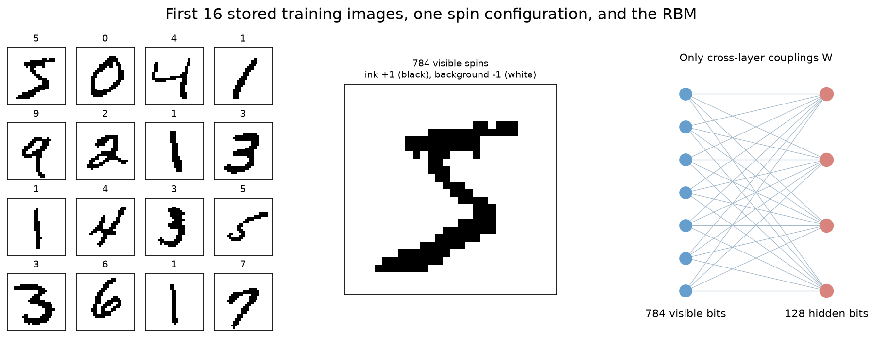

The code implements joint energy, visible free energy using stable softplus, and sampled binary block Gibbs updates. Training differentiates the batch mean
`F(data) - F(stop_gradient(sampled_endpoint))`.
The positive phase lowers the data free energy, and the negative phase uses the CD-k endpoint to approximate the model expectation in a likelihood gradient. Holding the endpoint fixed during differentiation gives the required CD update.

### Matched training settings and numerical results

The full settings are in `rbm.toml`: 60,000 training images, 20 epochs, batch size 100, shuffled each epoch, float32, plain SGD with learning rate 0.1, zero momentum and weight decay. Weights start as zero-mean normal draws with standard deviation 0.01; hidden biases are zero. Visible biases are the logits of full-training-set pixel frequencies clipped to [0.01, 0.99].

| Random stream | Seed |
|---|---:|
| Parameter initialization | 6601 |
| Data shuffle and training Gibbs draws | 6602 |
| Fresh generation | 6605 |
| Fixed held-out one-step evaluation | 6606 |
| Completion, including matched wrong-upper controls | 6607 |

Both models start with the same parameter hash and use identical epoch permutation hashes. Evaluation always uses the first 64 stored test images and the same Gibbs randomness. The only training difference is one versus ten Gibbs steps in the negative phase.

| Model | Initial sampled reconstruction error | Final error | Training seconds | Correct-upper Dice at 1000 | Wrong-upper Dice at 1000 | Correct-minus-wrong |
|---|---:|---:|---:|---:|---:|---:|
| CD-1 | 17.18% | 4.61% | 18.80 | 0.384 ± 0.023 | 0.218 ± 0.016 | 0.166 |
| CD-10 | 17.18% | 4.73% | 121.50 | 0.486 ± 0.020 | 0.244 ± 0.014 | 0.242 |

The ± values are standard errors across the 64 digits, after averaging each digit's eight chains. Both final reconstruction errors are below half their shared initial value. Both completion gaps exceed the required 0.1.

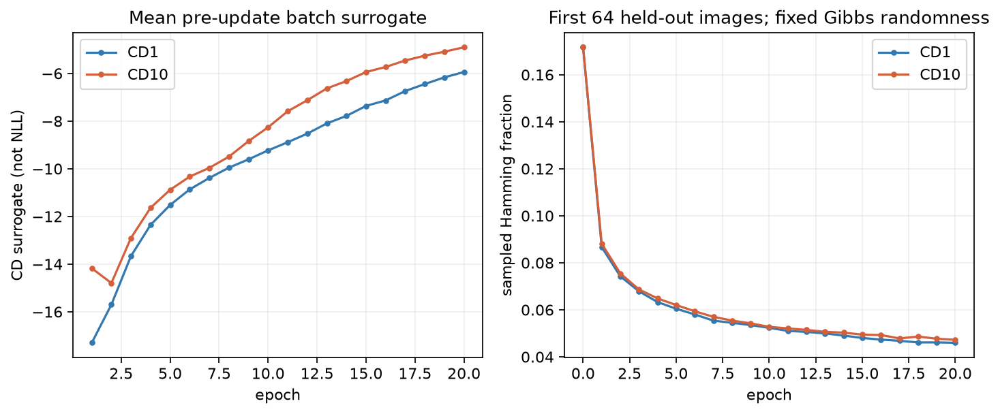

The surrogate rises toward zero while reconstruction improves. This is consistent with its role as an update surrogate: sampled negative endpoints change during training. It is **not** negative log likelihood; exact NLL would also require the changing `log Z`. Neither this curve nor a low reconstruction error proves good generation.

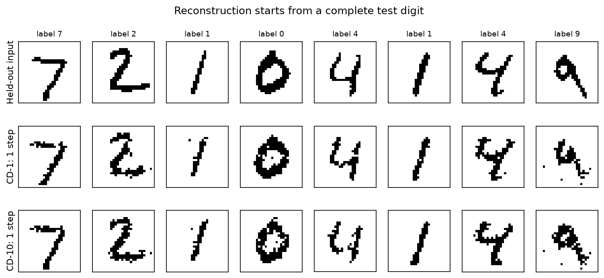

A one-step reconstruction can retain the supplied digit. Both fitted models reconstruct recognizable test digits with similar errors.

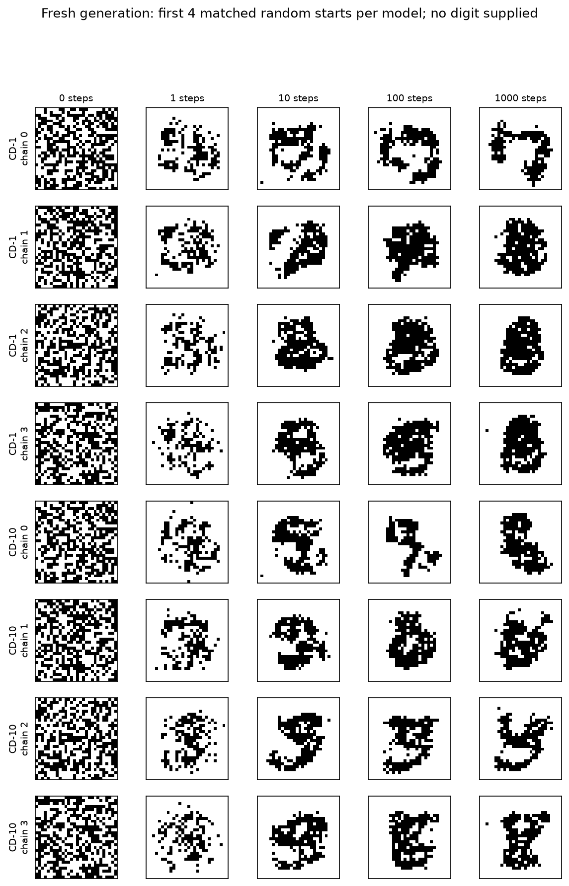

Fresh generation supplies no digit. The initial speckle forms connected blobs, strokes, and rings over longer sampling. CD-1 often produces thick closed shapes here; CD-10 also gives some thinner digit-like fragments, but malformed shapes remain in both. These are the first four chains in stored order, not selected good examples. Increasing generation steps changes a fixed model's sampling trajectory; increasing k in CD changes the training approximation. Neither guarantees clean or well-mixed generation.

### Completion is conditional inference

For each of the first 64 held-out digits, eight chains start with independent random missing pixels. After each Gibbs draw the observed upper 14 rows are reset exactly. The lower half is therefore sampled conditionally on that observation, with the learned parameters fixed.

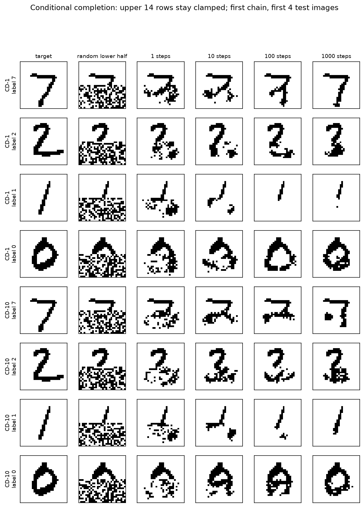

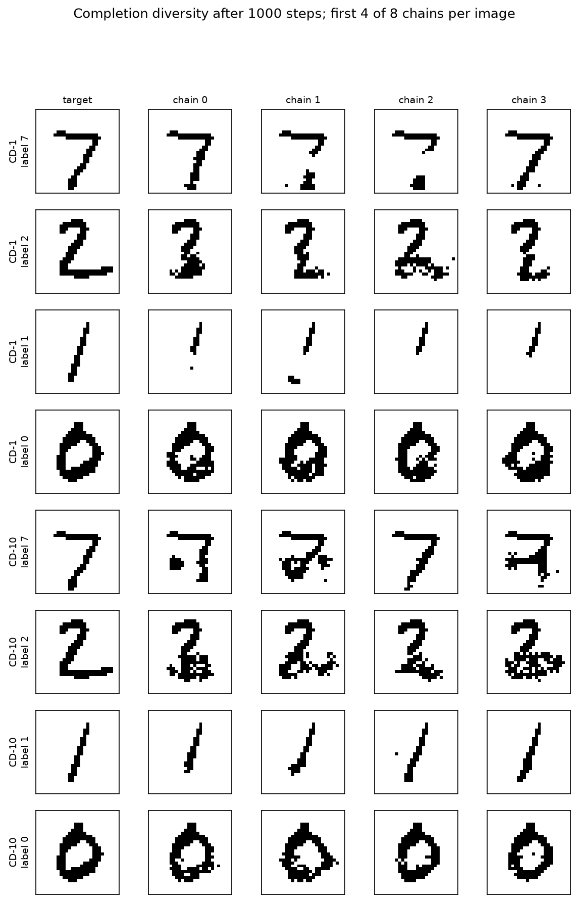

Different chains complete the same observed half differently. For the shown digit 1, CD-1 frequently leaves the missing lower stroke blank, while CD-10 often continues it. The displayed behavior agrees with the aggregate overlap comparison.

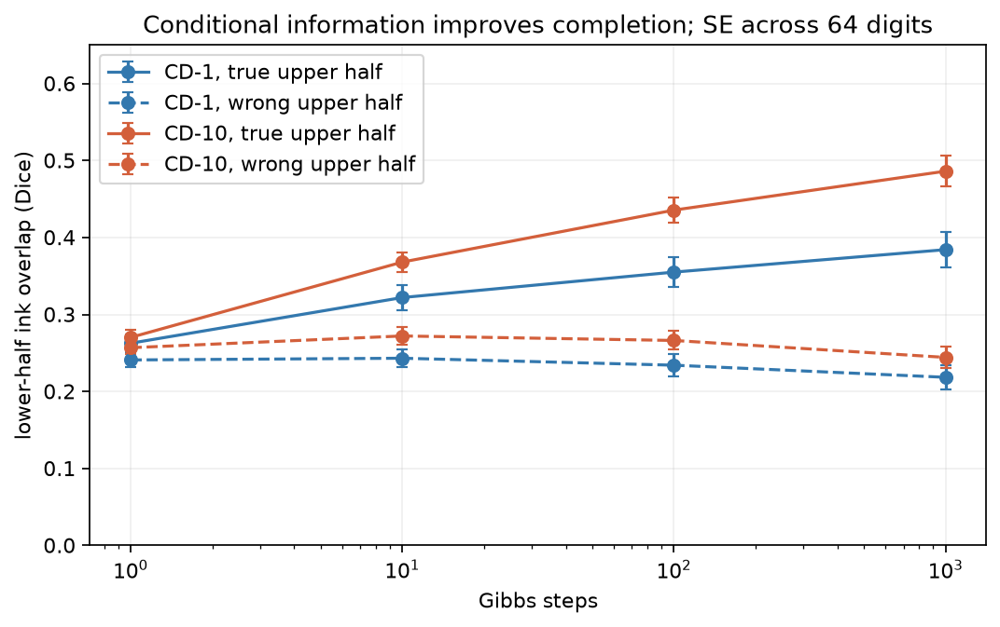

The control replaces each observation with the next evaluation image having a different label, wrapping within the 64 images. Correct and wrong conditions use the same initial missing bits and random streams. Correct observations increasingly improve the overlap; wrong observations remain near a background stroke-overlap baseline. The missing-half Dice score counts ink agreement, avoiding the misleadingly small Hamming error of blank completions.

Compact diagnostics are `evidence/rbm-training.json` and `evidence/rbm-sampling.json`. Local parameters, per-digit scores, and captured arrays remain under `artifacts/rbm/`.

## Part 3: Random-pattern Hopfield capacity

**Experiment producer:** `uv run python scripts/hopfield.py --part random`. **Figure producer:** `uv run python scripts/plot_results.py`.

Independent fair ±1 patterns set Hebbian couplings `J = Xi.T @ Xi / N`, with the diagonal explicitly zero. Recall updates one spin at a time in a new random permutation each sweep. Zero local field leaves the spin unchanged. Every run continues until a full sweep flips no spin.

The sweep uses N=100, 200, 400, 800 and alpha=0.05 through 0.25 inclusive in increments of 0.01, with 20 independent pattern sets per point. Each set recalls its first ten patterns, or all patterns if P<10. The seed is `6603000 + N*10000 + alpha_tick*100 + repeat`, where `alpha_tick=5..25` and `repeat=0..19`. Standard errors are across the independent pattern sets.

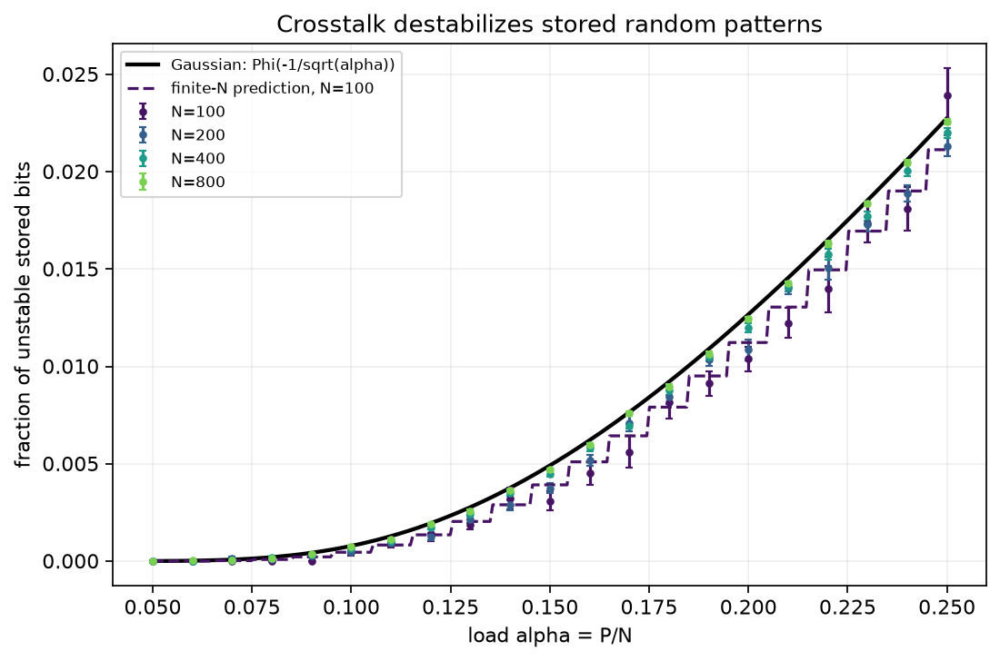

As N grows, the unstable fraction approaches `Phi(-1/sqrt(alpha))`. At finite N the more accurate expression is `Phi(-sqrt((N-1)/(P-1)))`, explaining the lower small-N points. A stored pattern contributes a stabilizing self-signal; the other independent patterns contribute approximately Gaussian crosstalk with variance approaching alpha. Increasing load raises the chance that crosstalk reverses a local field.

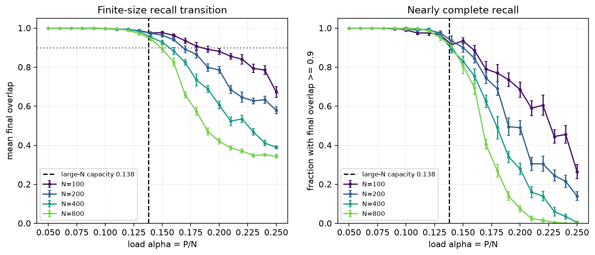

| N | Interpolated load where mean overlap crosses 0.9 | Recorded seconds |
|---:|---:|---:|
| 100 | 0.1847 | 0.85 |
| 200 | 0.1683 | 1.15 |
| 400 | 0.1562 | 5.19 |
| 800 | 0.1488 | 75.95 |

All four crossings are within 0.02 of the sheet's reference values and decrease toward 0.138 as N grows. The finite networks show a smooth transition that becomes sharper for larger N. Below the transition the recalled pattern is nearly intact; above it, cascades of unstable flips send recall to other local minima. Classical capacity here applies to independent random patterns; it cannot simply be transferred to highly correlated digit images.

The exact per-trial records and convergence counts remain in `artifacts/hopfield/`. `evidence/hopfield-N100.json`, `hopfield-N200.json`, `hopfield-N400.json`, and `hopfield-N800.json` contain compact means, standard errors, settings, seed rules, and runtime. `evidence/capacity-crossings.json` records the crossing calculation.

## Part 4: Modern Hopfield retrieval and attention

**Experiment producer:** `uv run python scripts/hopfield.py --part modern`. **Figure producer:** `uv run python scripts/plot_results.py`.

For P=3, 10, 30, 100, 300, 1000, the memory stores the first P binarized MNIST training images in original order. Each load uses 100 queries, cycling through the stored targets and replacing the lower half with fair random spins. The query seed is 6604, folded with P. Modern and classical methods receive the same queries and stored patterns.

The implementation compares `X softmax(beta X.T x)` with [JAX dot-product attention](https://docs.jax.dev/en/latest/_autosummary/jax.nn.dot_product_attention.html), using the query as Q, stored patterns as both K and V, and **explicitly setting `scale=beta`**. The maximum difference over all queries, six loads, and seven beta values is **4.828e-6**, below 1e-5 in float32. The independent small-system negative control uses the library's default scale and produces a difference of about 0.833, demonstrating why the scale matters.

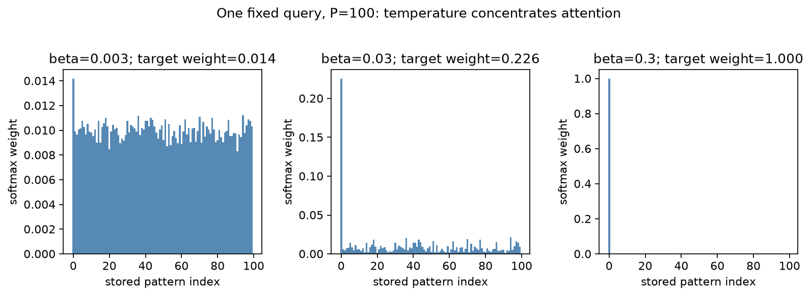

Small beta gives a broad weighted average. Increasing beta concentrates the weights on the closest stored pattern.

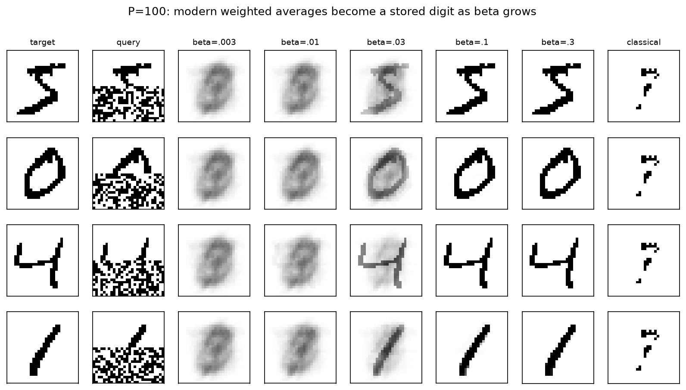

At P=100, small beta returns blurred averages. At beta=0.03 the queried shape appears within the average; beta>=0.1 strongly favors its stored target. Classical recall returns the same sparse stroke fragment across these very different queries. Digits share background and stroke pixels, violating the independent-pattern assumption of Part 3.

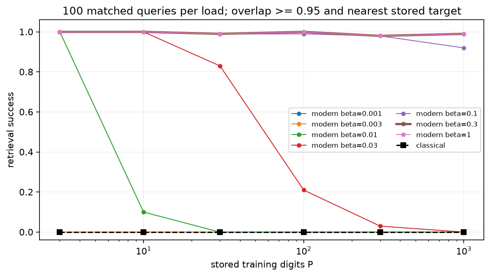

Success requires **both** signed overlap >=0.95 with the target and the target being the nearest stored digit. It is not credited solely for producing a similar-looking image.

| Stored P | Modern success, beta=0.3 | Classical success |
|---:|---:|---:|
| 3 | 100.00% | 0% |
| 10 | 100.00% | 0% |
| 30 | 99.00% | 0% |
| 100 | 100.00% | 0% |
| 300 | 98.00% | 0% |
| 1000 | 99.00% | 0% |

All beta=0.3 success rates exceed 0.90. At P=1000 and beta=0.1, success is 92%. The remaining modern failures can arise when the visible half favors a near-duplicate stored digit; stronger weighting cannot add information missing from the query. Classical digit recall fails even at very small P because shared background creates a common attractor.

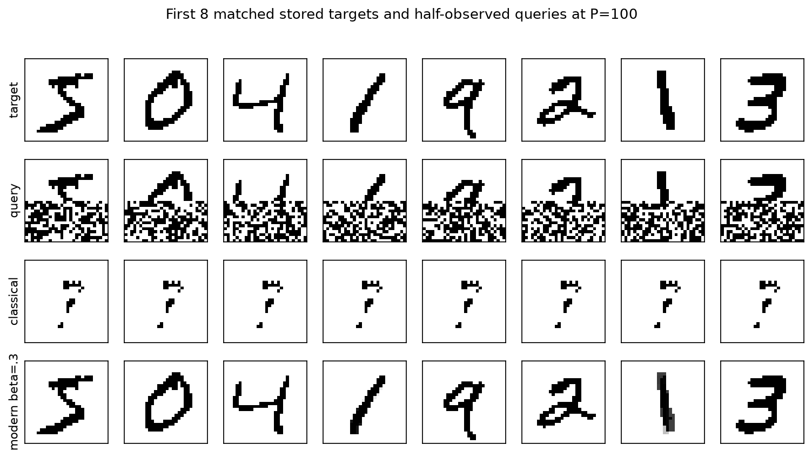

The RBM completion experiment infers unseen test digits from a fitted distribution. This modern memory instead retrieves one of its explicitly stored training images. Matching the algebra of attention does not make these two tasks identical.

## Final verification and evidence inventory

An unknown data-generating distribution describes the population of possible images. The empirical distribution gives equal mass to each observed record. Training fits an RBM distribution through its energy parameters. Gibbs sampling is the algorithm used to draw states from that fitted model, while clamping changes the sampling target to a conditional distribution of missing pixels. Hopfield experiments instead set memory couplings directly and measure retrieval.

`uv run python scripts/check_contracts.py` checks RBM free energy against explicit hidden-state enumeration, the AD CD gradient against its independent closed form, binary/clamped sampling, Hopfield energy reduction and stable stopping, exact zero-field ties, and attention equivalence with a wrong-scale negative control. `uv run python scripts/verify.py` audits the full experimental settings, matched starts, all clamped pixels, completion gaps, complete random-pattern sweep, capacity crossings, attention agreement, retrieval thresholds, and every embedded PNG path.

| Committed evidence | Producing command |
|---|---|
| `evidence/mnist-distribution.png`, `evidence/cifar10-distribution.png`, `evidence/dataset-counts.json`, `evidence/dataset-provenance.json` | `uv run python scripts/datasets.py` |
| `evidence/rbm-training.json`, `evidence/rbm-sampling.json` | `uv run python scripts/rbm.py` |
| `evidence/rbm-spins-network.png`, `evidence/rbm-learning.png`, `evidence/rbm-reconstructions.png`, `evidence/rbm-generation.png`, `evidence/rbm-completion.png`, `evidence/rbm-completion-diversity.png`, `evidence/rbm-completion-overlap.png` | `uv run python scripts/plot_results.py`, from the RBM run |
| `evidence/hopfield-N100.json`, `evidence/hopfield-N200.json`, `evidence/hopfield-N400.json`, `evidence/hopfield-N800.json` | `uv run python scripts/hopfield.py --part random` |
| `evidence/hopfield-unstable.png`, `evidence/hopfield-capacity.png`, `evidence/capacity-crossings.json` | `uv run python scripts/plot_results.py`, from the random-pattern run |
| `evidence/modern-metrics.json` | `uv run python scripts/hopfield.py --part modern` |
| `evidence/attention-weights.png`, `evidence/modern-temperature.png`, `evidence/modern-success.png`, `evidence/modern-retrieval.png` | `uv run python scripts/plot_results.py`, from the modern-memory run |
| `evidence/contract-checks.json` | `uv run python scripts/check_contracts.py` |
| `evidence/verification.json` | `uv run python scripts/verify.py` |

The locked project files, `rbm.toml`, source scripts, compact summaries, and all figures are versioned. Downloads and raw runs are ignored and recreated by the commands above. The evidence is ready to explain and demonstrate at the start of Week 7.
