# Week 7 — Diffusion and flow matching

Boyuan's implementation and measured results for the five parts of the Week 7 learning sheet. Training and production sampling use **JAX on CPU**. All 11 result figures and all three required movies are embedded below, beside their producing commands. Downloads, fitted weights and raw trajectories stay local and are ignored by Git.

The main checks pass: forward noise becomes approximately standard Gaussian, learned DDPM recovers the four clusters, DDIM is exactly repeatable, 20-step flow reaches energy distance **0.001952**, and all 16 RePaint completions retain the observed pixels **exactly**. Two qualifications are retained rather than concealed: DDIM has a slightly narrow right-hand cluster compared with the reference example; velocity extrapolation over the entire low-density square is less accurate than over the samples. Details and both evaluation domains are reported below.

## 1. Environment and reproduction

Run commands from this directory in Linux/WSL. `uv.lock` pins the numerical environment, `.python-version` pins Python 3.14.4, and `JAX_PLATFORMS=cpu` is the default in the code. The recorded run used JAX 0.11.2, NumPy 2.5.3, SciPy 1.18.1 and eight CPU cores on Ubuntu/WSL2. No GPU is needed.

```bash
cd week7
uv sync --frozen
bash scripts/reproduce.sh
```

The script downloads/verifies inputs, runs independent contract checks, trains both predictors from scratch, evaluates all samplers, generates photographs, performs all inpainting runs, creates every figure/movie, and audits the raw results. It chooses up to eight available CPU cores; set `WEEK7_CPUS=0-3` to choose another affinity. Expect several minutes on a comparable CPU; first-time model and CIFAR downloads need a working internet connection. Existing valid downloads are reused, not silently replaced. To repeat only the final audit after a run:

```bash
.venv/bin/python scripts/verify.py --with-artifacts
```

For a fresh clone without raw runs, `.venv/bin/python scripts/verify.py` checks the committed numerical evidence, configuration, figures and movie frames. It does not claim to regenerate raw results.

### Training settings

| Setting | Diffusion noise predictor | Flow velocity predictor |
|---|---|---|
| Architecture | 34 → 128 → 128 → 128 → 2, three SiLU hidden layers | Same architecture; newly initialized weights |
| Time features | 16 sine + 16 cosine, frequencies `10000**(-j/16)`, phase `t-1` | Same frequencies, phase `1000*s` |
| Initialization | Independent normal weights, SD `1/sqrt(fan_in)`; zero biases | Same rule |
| Training | 25,000 updates; 512 fresh samples/update; float32 | Same |
| Objective | Mean squared added-noise error per coordinate | Mean squared error against `z-x0` per coordinate |
| Optimizer | Bias-corrected Adam: β₁=0.9, β₂=0.999, ε=1e-8 | Same |
| Learning rate | `0.001/2 * (1+cos(pi*(update-1)/24999))`; exactly zero at final update | Same |
| Seed | 2026 | 2029 |
| Saved updates | 0, 50, 100, 200, 500, 1000, 2000, 5000, 10000, 25000 | 0 and 25000 |

The required settings are in `diffusion.toml` and `flow.toml`; unsupported edits are rejected instead of silently ignored. Full loss histories, checkpoints and settings are saved in `artifacts/`. Compact loss histories and environment records are committed in `evidence/diffusion-training.json` and `evidence/flow-training.json`.

## 2. Part 1 — Forward diffusion, learning, and DDPM

The exact target chooses each centre `(3,0), (0,3), (-3,0), (0,-3)` with probability 1/4, then adds independent normal noise with coordinate SD 0.30. The noise schedule has 1,000 linearly spaced variances from 0.0001 to 0.02. Forward transitions shrink by `sqrt(1-beta_t)` and add fresh noise of SD `sqrt(beta_t)`.

### Forward movie: the same 2,000 particles

```bash
.venv/bin/python scripts/mixture_experiments.py
.venv/bin/python scripts/plot_results.py
```

The first command writes all mixture experiments; the second renders their figures and movies. Every forward frame follows the same points, coloured by their original component. Axes remain fixed at `[-5,5]`.

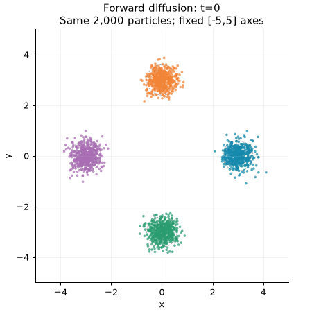

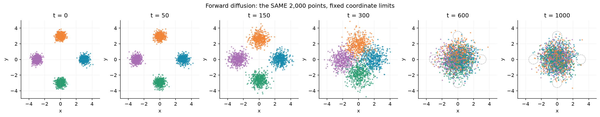

At `t=1000`, coordinate means are **(0.01833, 0.02427)** and variances are **(0.97081, 1.04568)**. Thus both mean magnitudes are below 0.1 and both variance errors are below 0.1. The four component labels become thoroughly mixed. This process contains no learned weights.

### Training-stage movie and loss

```bash
.venv/bin/python scripts/train.py diffusion
.venv/bin/python scripts/train.py flow
.venv/bin/python scripts/mixture_experiments.py
.venv/bin/python scripts/plot_results.py
```

The movie has all ten requested diffusion checkpoints, including initialization. Each frame shows **10 complete DDPM paths with the same initial Gaussian points and the same reverse-step noise**; only the predictor weights change. It also shows loss history only up to that checkpoint. The PNG summarizes four stages; its full-history loss plot has dotted lines at those four updates.

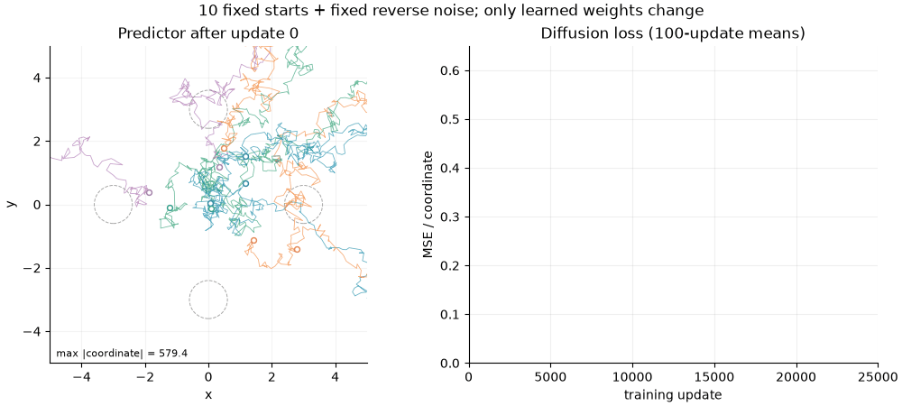

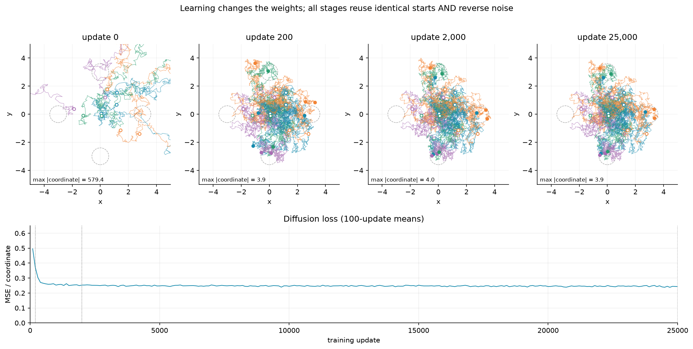

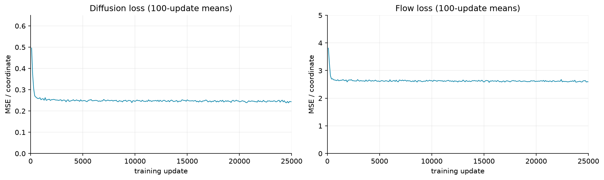

At initialization a path reaches a maximum absolute coordinate of **579.4**, outside the displayed square; the states are **not clipped**. Final endpoints lie around the four target modes. The final 1,000-update mean diffusion loss is **0.24365**; the flow loss is about **2.61**. Each training run took about 30 seconds in the recorded eight-core run, including compilation; the JSON records the actual timing.

A nonzero noise-prediction loss is expected: several clean points and noise draws can produce the same noisy input. Squared-error regression estimates the conditional mean noise, not the particular hidden draw. This explains irreducible uncertainty, but a plateau alone does not prove optimal training; the distributional checks below are still needed. The flow loss has a different target and scale and is not directly comparable to noise loss.

### Reverse movie and cluster statistics

```bash
.venv/bin/python scripts/mixture_experiments.py
.venv/bin/python scripts/plot_results.py
```

The DDPM sampler uses variance `beta_t` for adjacent reverse steps, no clipping, and no added noise in its final step. Generation starts from fresh Gaussian points rather than attempting to reconstruct the particular forward samples.

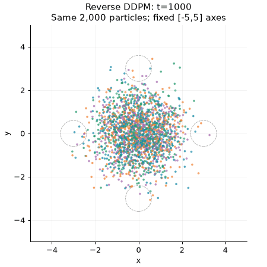

The following image also supplies Part 2's comparison with independent exact target draws. Each panel contains 2,000 points.

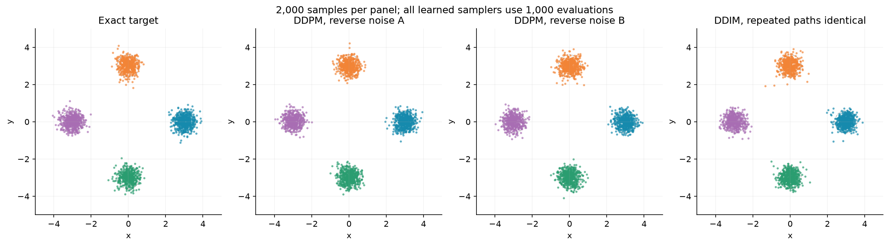

Assigning each endpoint to its nearest prescribed centre gives:

| DDPM mode | Population | Measured centre | Coordinate SDs |
|---|---:|---|---|
| Right, `(3,0)` | 0.2580 | (3.00446, -0.00685) | (0.29608, 0.30323) |
| Top, `(0,3)` | 0.2455 | (-0.00617, 2.97840) | (0.29594, 0.29695) |
| Left, `(-3,0)` | 0.2370 | (-2.98853, 0.03774) | (0.29921, 0.29379) |
| Bottom, `(0,-3)` | 0.2595 | (0.00993, -2.99471) | (0.30300, 0.30614) |

Maximum population error is **0.0130 < 0.04**; maximum centre-vector error is **0.03944 < 0.05**; maximum coordinate-SD error is **0.00621 < 0.03**. These three checks test different failures: equal populations alone would not detect shifted or over-broad modes.

## 3. Part 2 — Deterministic DDIM

The same diffusion predictor is reused without retraining. For selected original levels `t > t'`, DDIM estimates clean data and combines it with the predicted noise using the coefficients at `t'`. Network time input remains `t-1`, **not** the jump counter. Both learned and exact conditional-mean noise predictors are implemented.

```bash
.venv/bin/python scripts/mixture_experiments.py
.venv/bin/python scripts/plot_results.py
```

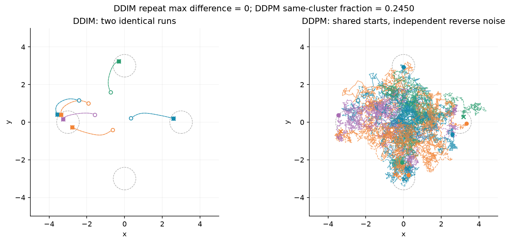

Two 1,000-level DDIM runs from identical starts have largest absolute difference **0**, over **all states and all 2,000 samples**, even when supplied different reverse RNG keys. Two DDPM runs share those starts but use independent reverse noise; their endpoints land in the same cluster **0.2450** of the time, close to the chance rate 1/4. The solid/dashed DDIM paths overlap; DDPM paths separate. White circles mark starts, filled points and crosses mark endpoints.

| DDIM mode | Population | Measured centre | Coordinate SDs |
|---|---:|---|---|
| Right | 0.2610 | (2.98751, -0.00520) | (0.27765, 0.27879) |
| Top | 0.2420 | (-0.01921, 3.00172) | (0.29972, 0.31002) |
| Left | 0.2430 | (-2.98969, 0.01564) | (0.30687, 0.29426) |
| Bottom | 0.2540 | (-0.02393, -2.98615) | (0.30182, 0.29912) |

DDIM's population error is **0.011 < 0.015**. Its largest centre error is **0.02765** and width error **0.02235**, within Part 1's tolerances. **Qualification:** the two right-mode widths are narrower than the sheet's illustrative reference interval `0.29–0.32`. This run is not an exact numerical reproduction of that reference. The discrepancy is retained in the table, source data and audit caveats; the model was not retrained with additional updates or selected for a better-looking sample set.

## 4. Part 3 — Flow matching and the cost of fewer steps

Flow training uses independent `x0` and standard-normal `z`, a fresh uniform `s`, position `(1-s)*x0+s*z` and target velocity `z-x0`. Sampling follows the learned field **backwards**, with Euler update `x_next = x - (s-s_next)*v(x,s)`.

### Exact predictors and velocity verification

For component centre μ, the diffusion marginal has mean `sqrt(abar_t)*μ` and variance `q=0.09*abar_t+1-abar_t`. Component posterior weights are its normalized Gaussian densities at the current point. With those weights `w`, the exact noise prediction is

```text
eps_exact(x,t) = sqrt(1-abar_t)/q * (x - sum_k w_k*sqrt(abar_t)*mu_k).
```

For flow, component mean is `(1-s)*μ`, variance `q=0.09*(1-s)^2+s^2`, and its conditional velocity is

```text
-mu + (s - 0.09*(1-s))/q * (x - (1-s)*mu).
```

Average those component velocities with their posterior weights to obtain the exact marginal velocity. `check_contracts.py` independently checks these identities using finite-difference log-density scores and conditional endpoint means. In particular `v(x,1)=x`.

```bash
.venv/bin/python scripts/mixture_experiments.py
.venv/bin/python scripts/plot_results.py --no-movies
```

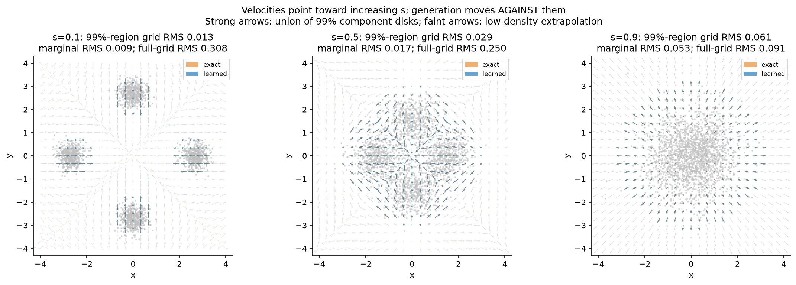

Arrows describe **increasing** `s`; generation runs against them. Both sets of arrow lengths are clipped to 2 solely for display. Numerical errors use the original, unclipped vectors.

The grid has 25×25 points over `[-4,4]^2`. To distinguish the grid **over the samples** from extrapolation in nearly empty space, its high-probability region is defined by the union of the four component 99%-probability disks: minimum component squared Mahalanobis distance ≤ `-2*log(0.01)`. This region contains at least 99% of the exact marginal probability. The rule depends only on the prescribed target, not on prediction errors. Strong arrows are inside this region; faint arrows show the remaining grid as an extrapolation diagnostic. All three diagnostics below use Eq. 18, not averaged signed errors.

| Time s | Grid over ≥99% probability region | 20,000 fresh exact marginal test points | Full unweighted square grid |
|---|---:|---:|---:|
| 0.1 | 0.01326 (84 grid points) | 0.00926 | 0.30783 |
| 0.5 | 0.02890 (229 grid points) | 0.01700 | 0.25041 |
| 0.9 | 0.06113 (261 grid points) | 0.05320 | 0.09125 |

The learned field satisfies **relative RMS < 0.1 over the sample region and under the marginal distribution**, consistent with the transport experiment. It does **not** satisfy that bound uniformly on the entire square: low-density extrapolation is visibly less accurate at `s=0.1,0.5`. This domain distinction is part of the result, not a claim that the whole square passes. No samples or endpoints were removed from the generation metrics.

### One shared step grid, measured cost and null scale

```bash
.venv/bin/python scripts/mixture_experiments.py
.venv/bin/python scripts/plot_results.py --no-movies
```

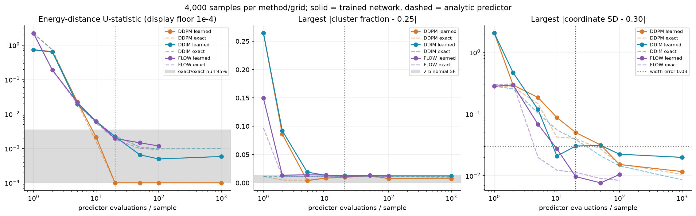

Each learned and analytic-predictor run generates **4,000 samples** from shared Gaussian starts. All methods use 1, 2, 5, 10, 20, 50 and 100 steps; DDPM and DDIM additionally use 1,000 levels. Coarse diffusion levels are rounded evenly spaced original schedule indices. DDPM jumps use effective ratio `a=abar_t/abar_t'`, variance `1-a`, and no final noise. Flow uses equal intervals in `s`. Exact controls use identical starting points and step grids.

We compare with 4,000 independent exact target points using the **energy-distance U-statistic with distinct within-set pairs, no square root**. Twenty additional pairs of independent 4,000-point exact sets give a null 95% quantile **0.0034383**. The fraction plot shades **two binomial standard errors = 0.0136931** for `p=0.25,N=4000`. The width plot marks the specified 0.03 tolerance, not an invented null band.

Finite-sample U-statistics can be slightly negative. The original signed values remain in JSON; only the log-axis display floors values below `1e-4` to `1e-4`, as in the sheet. Empty clusters in collapsed analytic controls have undefined centre/width, stored as JSON `null` and omitted from those curves, not silently counted as correct.

At **20 steps**, learned flow gives energy distance **0.001952 < 0.005** and largest width error **0.00971 < 0.03**. Learned DDIM gives distance **0.002209**, but a slightly larger width error **0.03033**. DDPM's 20-step width error is about **0.0502**, improving to about **0.0316** at 50 and **0.0153** at 100 steps. Thus flow reaches the requested accuracy in tens of evaluations, DDIM is competitive, and DDPM needs more steps to get its widths right. This run does **not** establish a large universal speed advantage for flow, and energy distance alone at this sample size can conceal a small width error. Full cluster fractions, centres and coordinate widths for every run are recorded in `evidence/mixture-metrics.json`.

### Coarse-step negative controls

```bash
.venv/bin/python scripts/mixture_experiments.py
.venv/bin/python scripts/plot_results.py --no-movies
```

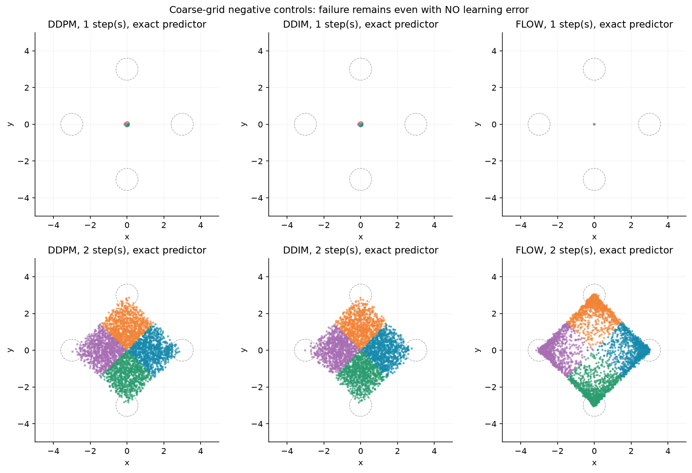

Even exact predictors fail with one or two coarse steps. A one-step DDIM returns the conditional clean mean at almost pure noise; all four modes remain possible, so the average is near the origin. A one-step exact flow update is exactly `x-v(x,1)=0`. Two steps still distort the modes. These controls remove learning error: the remaining collapse comes from the coarse sampling rule. Intermediate steps repeatedly recompute the prediction as the state becomes informative.

## 5. Part 4 — Fixed pretrained predictor on photographs

### Pinned download and independent architecture check

```bash
.venv/bin/python scripts/prepare_inputs.py
# Equivalent pinned model download:
uv run --with huggingface-hub==1.33.0 hf download google/ddpm-cifar10-32 \
  config.json diffusion_pytorch_model.safetensors \
  --revision 267b167dc01f0e4e61923ea244e8b988f84deb80 \
  --local-dir inputs/cifar-model
```

The model is `google/ddpm-cifar10-32`, revision **267b167dc01f0e4e61923ea244e8b988f84deb80**. Weight SHA-256 is `1558dbe3fb093b0857d473e376b711eeda1b186c557be5e85b3a56300cd49f0f`. Input URLs, byte counts and hashes are recorded in `evidence/input-provenance.json`. The prepared course image archive comes from `https://giggleliu.github.io/AMAT5315-2026Fall/downloads/week7-images.npz`.

`scripts/unet.py` implements the fixed model in **pure JAX**: convolutions, GroupNorm, time embeddings, residual blocks, spatial attention and skip connections. It matches the architecture of [diffusers v0.40.0](https://github.com/huggingface/diffusers/tree/v0.40.0). The checkpoint contains 328 tensors / 35,746,307 parameters. Input and output have public shape `B×3×32×32`; mathematical level `t` is passed as checkpoint index **`t-1`**. Arrays are float32; weights are never trained or updated.

An optional independent oracle uses PyTorch/diffusers **only to verify the port**, never for production generation:

```bash
uv pip install --python .venv/bin/python -r reference-requirements.txt \
  --index-strategy unsafe-best-match
taskset -c 0-7 .venv/bin/python scripts/check_unet_reference.py
# Restore the lightweight production environment afterwards:
uv sync --frozen
```

Two fixed random input images were compared at model indices 0, 499 and 999. Maximum absolute output errors were **7.63e-6, 4.77e-6 and 5.48e-6**, respectively, against `diffusers.UNet2DModel` v0.40.0 with the same checkpoint. Full details are in `evidence/unet-reference.json`.

### Four new images and reverse stages

```bash
.venv/bin/python scripts/photo_experiments.py --part generation
.venv/bin/python scripts/plot_results.py --no-movies
```

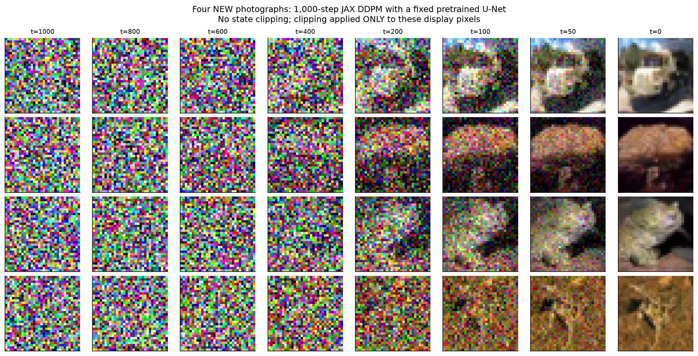

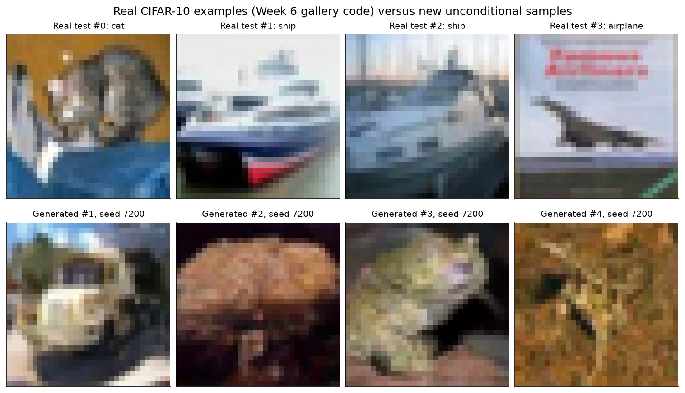

Generation uses seed **7200**, 1,000 DDPM steps and fresh reverse noise, with no state clipping. The recorded four-image generation took about **100 seconds**. Final state extrema were **-1.0318 and 1.0112**, further confirming the state was not constrained to the clean display range. Only rendering applies `(x+1)/2` and clips to `[0,1]`.

The real examples are decoded and displayed with the actual **Week 6 `load_cifar` and `show_image` gallery helpers**, retaining their original test-set order. The generated examples develop coherent colours and object-like shapes at the same 32×32 resolution; the first has a vehicle-like front and the middle examples have animal-like contours. Some object identities remain ambiguous, especially the fourth image. The model is unconditional: we did not ask it for those classes or claim classification accuracy. Structure is much clearer between `t=200` and `t=50` than at the early noisy stages.

**What was learned before download?** The noise predictor's visual features and weights were learned from CIFAR-10 beforehand. **What is computed now?** Our JAX implementation evaluates that fixed predictor at each current noisy image, and our DDPM sampler computes reverse means and adds the prescribed random noise. No photograph training occurs in this repository.

## 6. Part 5 — RePaint completion from observations only

```bash
.venv/bin/python scripts/prepare_inputs.py
.venv/bin/python scripts/photo_experiments.py --part inpainting
.venv/bin/python scripts/plot_results.py --no-movies
```

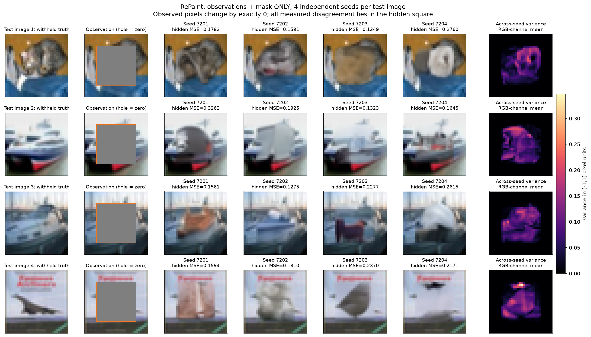

All four **test** images are used; validation images are not substituted. The mask is 1 on observed entries and 0 in rows and columns `6:26`, all RGB channels: **400 pixels / 1,200 scalar values hidden per image**. Hidden observation entries are set to zero (displayed as grey). The sampler accepts only **fixed weights, observed image, mask and RNG key**. Withheld truth is used afterwards solely for MSE and display.

We implement the sheet's full RePaint loop: 50 jumps `1000,980,...,20,0`; two attempts per jump except the final jump once; forward noise between retries; and independently noised observations merged after each reverse proposal. This costs **49×2+1 = 99 network evaluations per completion**. The posterior-jump variance is `(1-abar_t')*(1-a)/(1-abar_t)`, **not** Part 3's `1-a`. Only the estimated clean image is clipped to `[-1,1]`, as required; noisy states are not clipped.

Hidden-pixel MSEs in `[-1,1]` pixel units, averaging over all 1,200 hidden entries:

| Test image | Seed 7201 | Seed 7202 | Seed 7203 | Seed 7204 |
|---|---:|---:|---:|---:|
| 1, cat | 0.178162 | 0.159051 | 0.124927 | 0.276036 |
| 2, ship | 0.326151 | 0.192529 | 0.132279 | 0.164457 |
| 3, ship | 0.156087 | 0.127542 | 0.227742 | 0.261479 |
| 4, airplane | 0.159425 | 0.180954 | 0.236984 | 0.217131 |

Across all 16 completions, mean hidden MSE is **0.195058**. The largest observed-pixel change is **0 for every image and every seed**, below `1e-5`. Maximum variance outside the hole is **0**; mean per-channel variance inside the hole is **0.0673725**. The displayed map averages the three channel variances for each spatial pixel, with one shared colour scale for the four images. Full per-channel variance and all intermediate states remain in `artifacts/photographs/inpainting.npz`.

The cat's face and the ships' central structures vary visibly across seeds. Every completion has identical visible context, yet the hidden content differs. A plausible fill is not necessarily the withheld truth: MSE measures reconstruction error, whereas across-seed variance measures disagreement among possible completions. These are distinct quantities. The four-seed result is not a calibrated uncertainty estimate. At the final jump, the known-pixel noise coefficient becomes zero, so the observations are inserted exactly.

## 7. Verification, evidence map and what stays local

```bash
.venv/bin/python scripts/check_contracts.py
.venv/bin/python scripts/verify.py --with-artifacts
```

The **17 independent contract checks** cover schedule coefficients, time encoding, MLP structure, exact noise via finite-difference scores, exact velocity via independent posterior conditioning, DDIM determinism and correct coarse-level indexing, absence of final DDPM noise, and the distinct-pair energy statistic. An instrumented lightweight RePaint predictor verifies **all 99 actual calls and their `t-1` indices**, final pixel preservation and clean bounds without needing the hidden truth. The optional reference test checks the real image network against an independent implementation. The complete end-to-end reproduction passed **228 audit checks**: the final audit also recomputes cluster metrics and every inpainting MSE/variance from the raw arrays, verifies figures decode, counts movie frames and checks every embedded README image path. Machine-readable outputs are `evidence/contract-checks.json` and `evidence/acceptance.json`; both numerical qualifications above are recorded as caveats, not discarded.

| Sheet requirement | Source / measured evidence |
|---|---|
| Part 1: target, forward movie, terminal moments | `scripts/network.py`, `scripts/transport.py`; forward GIF and stage PNG above |
| Part 1: prescribed training and checkpoints | `diffusion.toml`, `scripts/train.py`; stage GIF, stage PNG, training JSON |
| Part 1: 2,000-point reverse movie and all mode statistics | Reverse GIF, sampler PNG; `evidence/mixture-metrics.json` |
| Part 2: deterministic repeat, stochastic contrast, analytic noise option | `scripts/transport.py`; trajectory PNG, four-panel sample PNG, repeat max difference |
| Part 3: independently trained flow and exact velocity | `flow.toml`, `scripts/network.py`; loss/velocity PNGs and both evaluation-domain errors |
| Part 3: every step grid, 4,000 samples, 20-pair null | Transport-cost PNG, analytic coarse controls PNG; full per-run statistics in JSON |
| Part 4: pinned fixed JAX model, 4 images, stages, real comparison | `scripts/unet.py`, `scripts/photo_experiments.py`; two photograph PNGs, reference/provenance JSON |
| Part 5: observation-only RePaint, all 16 completions, MSE, preservation, variance | Inpainting PNG, full 16-entry MSE table and `evidence/photograph-metrics.json` |
| Reproducibility and Git hygiene | `pyproject.toml`, `uv.lock`, `scripts/reproduce.sh`, `.gitignore`; no raw runs or downloaded weights tracked |

Committed: source, required TOMLs, environment/lock files, compact JSON evidence, **11 PNG figures and 3 GIF movies**, this README. Local only: `inputs/` (model/downloads), `artifacts/` (full raw runs and fitted MLP weights), `.venv/`, Python caches. Approximate raw artefact size is 117 MB, excluding downloaded model/data. All random seeds are fixed and recorded in JSON. CPU timing and tiny floating-point differences can vary by machine.

The sheet asks to push source, environment and evidence, then **show the completed work at the start of Week 8**; it explicitly says there is no separate formal submission. This repository prepares that demonstration; it does not claim the classroom demonstration has already happened.
