# Week 8 — Language models and the transformer

Boyuan's measured results for all six parts of the Week 8 learning sheet. Models run in **JAX on CPU**, with NumPy/SciPy checks. **All 13 result figures are embedded directly below**, beside their producing commands. The optional signed-MLP-unit audit and all eight attention-head maps are included too.

Main results: the three embedding-relation cosines are **0.466, 0.549, 0.433**; the best count model is the **4-gram at 1.30975 bits/character**; the trained transformer reaches **1.21595**. All nine sampler tests pass. The scaling refit gives **alpha=0.34731, beta=0.36717**, and **17.92 training tokens per parameter** at Chinchilla's budget.

## 1. Reproduce the work

Run from this directory in Linux/WSL with `uv` installed:

```bash
cd week8
uv sync --frozen
bash scripts/reproduce.sh
```

The script prepares the pinned data, runs every experiment, trains both language models from scratch for their prescribed budgets, renders all figures, runs independent implementation contracts and audits the raw results. Python 3.14.4 is pinned by `.python-version`; `uv.lock` fixes the dependencies. The recorded environment uses JAX 0.11.2, NumPy 2.5.3, SciPy 1.18.1, SentencePiece 0.2.1 and Tokenizers 0.22.2 on Ubuntu/WSL2. There is **no PyTorch dependency and no GPU requirement**.

The script chooses up to eight available CPU cores. To change affinity, for example, set `WEEK8_CPUS=0-3`. The first complete capacity sweep took about **319 seconds**; the final reproduction trained the transformer in about **118 seconds** and the MLP in about **9 seconds**. CPU timing depends on other workloads. First-time downloads/installations take additional time. Capacity runs cache the per-key raw measurements; force their full recomputation with:

```bash
OPENBLAS_NUM_THREADS=8 taskset -c 0-7 .venv/bin/python scripts/memory.py --fresh
```

The ordinary reproduction retrains both neural models from initialization, never continues a fitted checkpoint or adds updates. It reuses already downloaded inputs and cached capacity measurements. Each JSON records the seeds, actual settings, environment and measured results; `memory-metrics.json` distinguishes cache reuse from newly computed cases.

After reproduction, independently audit all local raw arrays:

```bash
.venv/bin/python scripts/check_contracts.py
.venv/bin/python scripts/verify.py --with-artifacts
```

For a fresh clone without local raw arrays, `.venv/bin/python scripts/verify.py` checks the committed evidence and embedded figures without overwriting the original full-run audit. It does not claim to have retrained the models.

## 2. Pinned inputs and the two different tokenizers

```bash
.venv/bin/python scripts/prepare_data.py
```

| Input | Pinned download |
|---|---|
| Pretrained embedding matrix and its word-piece tokenizer | `minishlab/potion-base-8M`, revision `bf8b056`, files `model.safetensors` and `tokenizer.json` |
| TinyStories BPE tokenizer | `karpathy/tinyllamas`, revision `0bd21da`, file `stories260K/tok512.model` |
| Story corpus | [TinyStoriesV2-GPT4-valid.txt, revision f54c09fd23315a6f9c86f9dc80f725de7d8f9c64](https://huggingface.co/datasets/roneneldan/TinyStories/resolve/f54c09fd23315a6f9c86f9dc80f725de7d8f9c64/TinyStoriesV2-GPT4-valid.txt) |
| Digitized Chinchilla runs | [svg_extracted_data.csv, revision 92258837425e1b5f2851d624287f0120583a3d0e](https://raw.githubusercontent.com/epoch-research/analyzing-chinchilla/92258837425e1b5f2851d624287f0120583a3d0e/data/svg_extracted_data.csv) |

Full URLs, file sizes and SHA-256 hashes are in `evidence/data-provenance.json`. The corpus is split at `<|endoftext|>`, each story is stripped, empty stories are removed, and the first **90% of whole stories in file order** are training data. No random reshuffle or validation-based fitting is used.

| Split | Stories | Tokens, including EOS separators | Original stripped characters | Characters/token |
|---|---:|---:|---:|---:|
| Training | 24,867 | 9,667,035 | 19,853,989 | 2.05378 |
| Held-out validation | 2,763 | 1,078,996 | 2,213,915 | 2.05183 |

**These are two different vocabularies.** Part 1 uses the pretrained 29,528×256 Model2Vec table to study individual word pieces. Parts 2–5 use the **512-token SentencePiece BPE** vocabulary, including three special tokens, 256 byte fallbacks and 253 merged pieces. Their trainable embeddings are learned from scratch, not copied from Model2Vec. EOS is token 2 and separates stories. Decoding reproduces every validation story except **three**, where SentencePiece normalizes a double space. The original character count, not the normalized decoded count, is used consistently for bits/character.

## 3. Part 1 — Meaning as directions in an embedding table

```bash
.venv/bin/python scripts/embeddings.py
```

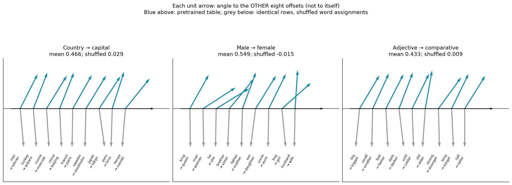

A token ID only selects a row; neighbouring integers need not have related meanings. An embedding lookup is a one-hot row vector multiplied by the table. Each prescribed word was verified to occupy one token, and every row was scaled to unit norm before forming the 27 offsets. Each pair's cosine is against the **average of the other eight offsets**, excluding itself.

| Relation, nine prescribed pairs each | Mean leave-one-out cosine | Shuffled-row mean, seed 1730 | Largest absolute mean over 20 shuffles |
|---|---:|---:|---:|
| Country → capital | 0.46587 | 0.02947 | 0.08884 |
| Male → female | 0.54852 | -0.01480 | 0.06235 |
| Adjective → comparative | 0.43300 | 0.00877 | 0.08495 |

Each blue upper arrow is a unit vector at that pair's angle to the horizontal reference direction. Grey lower arrows repeat the same test after row shuffling. All three learned means exceed **0.3**; all controls are inside **±0.15**, and all 20-shuffle means are within **±0.09**. Shuffling preserves the vector collection and its geometric distances but changes which words receive the vectors. The relation is therefore in the word-to-vector assignment, not in arbitrary token IDs.

## 4. Part 2 — Counts, normalization and the n-gram ladder

```bash
.venv/bin/python scripts/ngrams.py
```

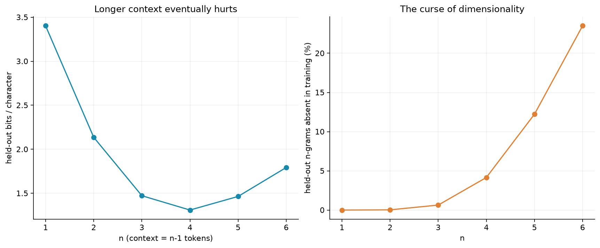

An n-gram keeps only the last `n-1` tokens. Counts give its maximum-likelihood next-token probabilities; add-k smoothing gives `(count(context,token)+k)/(count(context)+512*k)`. We choose k from `0.0001, 0.001, 0.01, 0.1, 1` **only on the last 10% of the training tokens**, fitting the earlier 90%, then refit the chosen model on all training tokens. The held-out stories are not used to choose k.

| Model | Selected k | Held-out nats/token | Perplexity | Bits/character | Held-out n-grams absent in training |
|---|---:|---:|---:|---:|---:|
| Uniform | — | 6.238325 | 512.000 | 4.386331 | — |
| Unigram | 0.0001 | 4.839400 | 126.394 | 3.402710 | 0.000% |
| Bigram | 0.01 | 3.038192 | 20.867 | 2.136233 | 0.027% |
| Trigram | 0.01 | 2.094340 | 8.120 | 1.472586 | 0.633% |
| 4-gram | 0.01 | 1.862755 | 6.441 | **1.309752** | 4.151% |
| 5-gram | 0.01 | 2.082535 | 8.025 | 1.464285 | 12.225% |
| 6-gram | 0.001 | 2.550397 | 12.812 | 1.793252 | 23.499% |

Perplexity is `exp(mean negative log probability)`; bits/character is total negative log probability divided by `log(2)` and the original held-out character count. The uniform loss is exactly `log(512)`. All specified metric tolerances are satisfied.

### Exact normalization and actual ancestral sampling

For fixed initial EOS context, we explicitly enumerate the **512, 512² and 512³** possible sequences, not just assert that the transition rows sum to one:

| Sequence length | Sum of sequence probabilities | Absolute error from 1 |
|---|---:|---:|
| 1 | 1.0000000000000000 | 0 |
| 2 | 1.0000000000000007 | 6.66e-16 |
| 3 | 0.9999999999999968 | 3.22e-15 |

The length-3 sum includes all **134,217,728** products, processed in chunks. All errors are below **1e-12**. The chain rule gives a product of normalized finite next-token distributions, so summing one token after another normalizes every fixed-length sequence without an intractable global partition function.

An actual **250,000-token bigram Markov chain**, seed **1849**, gives pooled Pearson **χ²=1206.482, df=1208, p=0.506914** after the 20 most frequent training tokens. Rare expected categories are pooled; the smallest expected bin is 5.019. This exceeds the required p-value 0.001. The sampler conditions on the immediately preceding generated token, not the token two steps back.

The best count model is the **4-gram**. By n=6 the possible context space is `512**5 = 35,184,372,088,832`, versus only 9.67 million training tokens. About a quarter of held-out n-grams were never seen; unseen contexts reduce to the uniform prediction. Longer context is informative in principle, but its count estimates become too sparse. Similar contexts do not share parameters, which motivates the neural models.

## 5. Part 3 — Memories in matrices and MLP weights

```bash
OPENBLAS_NUM_THREADS=8 taskset -c 0-7 .venv/bin/python scripts/memory.py
```

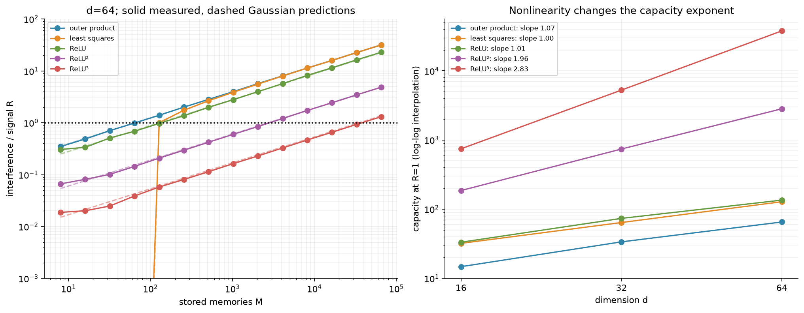

The sweep uses **d=16,32,64**, every power-of-two M from **8 through 65,536**, and **three independent draws** per dimension. Keys and values are independent random unit vectors; nested prefixes provide the different M within each draw. **Every stored key is queried**, not a small subset. For each draw we take RMS interference/signal over those queries, then take the median of the three draws. Per-key raw ratios are retained in `artifacts/memory/`.

| Store | Capacity at d=16 | Capacity at d=32 | Capacity at d=64 | Fitted capacity exponent |
|---|---:|---:|---:|---:|
| Outer product | 14.72 | 33.62 | 65.14 | 1.073 |
| Least-squares linear | 31.98 | 63.98 | 127.97 | 1.000 |
| ReLU | 33.21 | 73.48 | 134.94 | 1.011 |
| ReLU² | 185.59 | 739.42 | 2,824.80 | 1.964 |
| ReLU³ | 744.91 | 5,259.57 | 37,779.27 | 2.832 |

Capacities are where **R=1**, interpolated on log-log axes. The d=64 outer-product capacity lies in **50–85**, and the least-squares capacity in **100–170**. Least squares recalls all keys exactly to numerical precision while M≤d, with R below **1e-10**. All measured large-M interference slopes are close to **1/2**. Capacity slopes satisfy all requested ranges.

The outer-product store writes `sum_i value_i * key_i.T` into one matrix. Its interference grows as `sqrt(M/d)`. Least squares can fit arbitrary facts exactly through M=d. **Its own signal is `H_jj * value_j`, where H is the projection matrix**, so the interference ratio must divide by H_jj; using the ordinary residual against `value_j` would give the wrong capacity. This convention is independently checked against a small explicit projection matrix.

ReLU removes negative similarities; its powers suppress small positive similarities while leaving a matching key's weight at one. The Gaussian approximation predicts capacity `2*d**p/(2*p-1)!!`. Finite-dimensional unit vectors have bounded similarities, so the cubic exponent across these modest dimensions is below three, as expected. The measured slopes concern this specified sweep, not a claim that every learned network stores arbitrary facts at these capacities.

### An MLP learns the bigram's conditional table

```bash
.venv/bin/python scripts/train_language.py mlp
.venv/bin/python scripts/language_analysis.py
```

The one-token MLP has a **64-dimensional learned embedding**, **512 tanh hidden units** and a biased 512-token softmax readout: **328,704 parameters**. It trains for **4,000 AdamW updates of 16,384 actual sampled examples**, peak learning rate **0.006**, 200-step warmup, then cosine decay to 0.0006. Seed is 1838. It reaches **3.043254 nats/token**, versus the bigram's **3.038192**: a difference of **+0.005063 < 0.01**. It has the same one-token information budget as the bigram; its shared hidden units learn an approximation to those conditional distributions.

For efficiency, repeated previous-token inputs within each actual batch are evaluated once, weighting their log-probabilities by the sampled pair counts. This is **exact reuse of computation**, not reducing the batch or substituting the full count table for stochastic training. Independent per-example and aggregated losses and **every parameter gradient** are checked to agree.

Both neural models use bias-corrected AdamW, β₁=0.9, β₂=0.999, ε=1e-8, weight decay 0.01 on matrices only, global gradient norm clipping at 1, and float32. These choices, plus the MLP warmup duration, fill in settings the sheet does not specify; they are recorded, not selected using the validation loss.

### Optional extension: inspect all signed hidden-unit sides

```bash
.venv/bin/python scripts/inspect_mlp.py
```

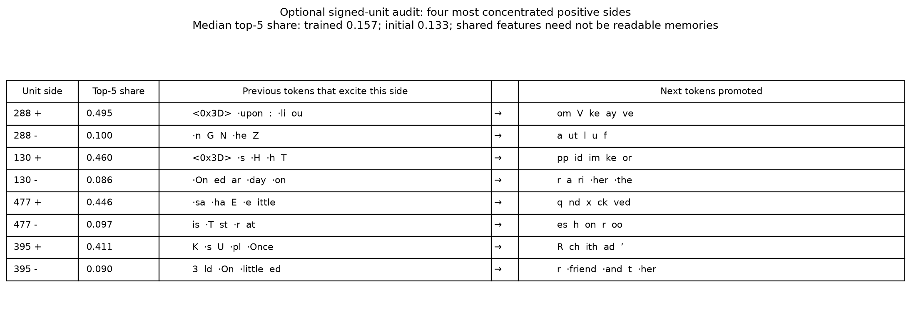

All **1,024 positive/negative sides** of the 512 tanh units are listed in `evidence/mlp-unit-audit.json`. For each side we report its five strongest previous tokens, five promoted next tokens and the share of squared activation carried by the strongest five previous tokens. The median share is **0.157 trained versus 0.133 initialized**. The table still mixes word pieces; increased concentration alone does not establish a readable semantic concept. These are our measured extension results, not numbers adjusted to match the narrative reference example.

## 6. Part 4 — A memory supplied by the context: attention

```bash
OPENBLAS_NUM_THREADS=8 taskset -c 0-7 .venv/bin/python scripts/memory.py
```

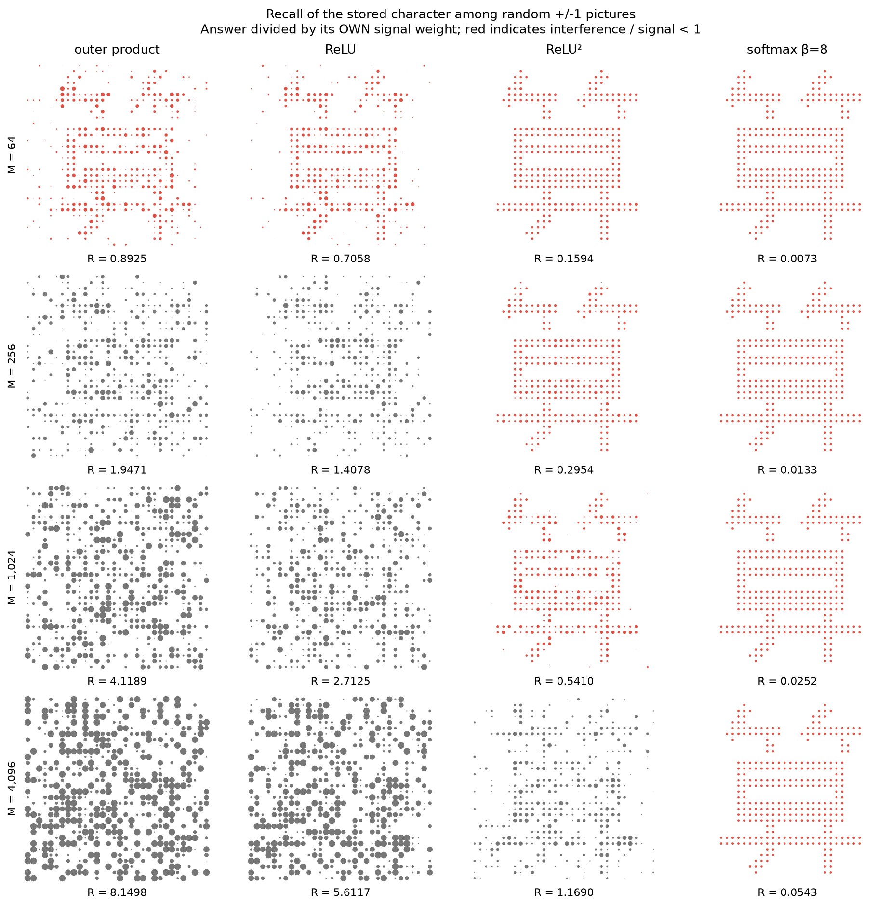

We store a portable **32×32 stroke drawing of 算**, with +1 for ink and -1 for background, among random ±1 pictures with random unit keys in **d=64**. Its own key is the query. The figure uses the first predetermined draw, seed 1780; the following table gives **medians over 20 draws**, seeds 1780–1799. Every figure panel also prints its own single-draw ratio, so the two are not confused.

| Stored memories M | Outer product R | ReLU R | ReLU² R | Softmax β=8 R |
|---|---:|---:|---:|---:|
| 64 | 0.99149 | 0.66524 | 0.13366 | 0.00618 |
| 256 | 1.99511 | 1.39683 | 0.28804 | 0.01324 |
| 1,024 | 4.01438 | 2.80376 | 0.59627 | 0.02794 |
| 4,096 | 8.02258 | 5.61123 | 1.19487 | 0.05613 |

At M=1024, outer-product/ReLU medians agree within 15% with **4** and **2.83**. ReLU² loses the character beyond capacity at M=4096, R>1. Softmax remains below **0.1 at every M**, retaining the character among 4096 memories.

Each recall is divided by **its own memory's weight** before measuring or drawing it. Dot area grows with the positive recalled pixel, capped only for display; numerical ratios use unclipped arrays. Red denotes R<1. Softmax normalizes all weights by one common factor, leaving the interference/signal ratio unchanged. With unit keys and β=8, the own memory gets relative weight `exp(8)`, far above unrelated memories. Learned attention queries/keys have length about sqrt(d), so scaling their dot product by `1/sqrt(d)` corresponds to this sharpness at d=64. The pairs in attention come from the tokens currently read; unlike MLP weights, they need not have appeared in training.

## 7. Part 5 — Train and sample the transformer

```bash
.venv/bin/python scripts/train_language.py transformer
.venv/bin/python scripts/language_analysis.py
```

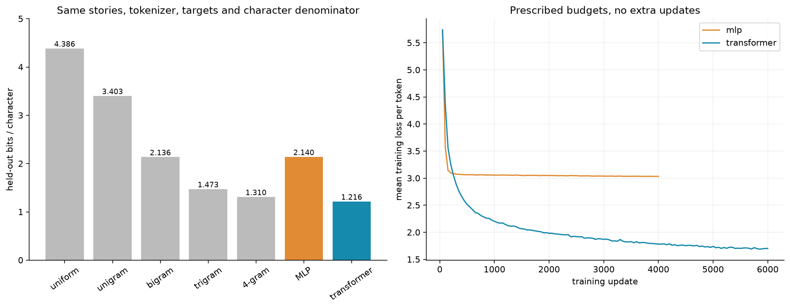

The transformer is a **pre-norm decoder: 2 layers, width 96, 4 heads, context 64**, learned token and position embeddings, GELU MLP width 384, final layer norm and a separate readout. Every linear map has a bias, including Q/K/V, attention output, both MLP maps and readout. It has **328,832 parameters**. Each head has width 24 and scales its dot products by `sqrt(24)`; future positions receive exactly zero attention. Layer norm ε is 1e-5. Residual connections wrap both sublayers.

Training uses **6,000 AdamW updates, 32 sequences of 65 consecutive training tokens per update**, predicting the final 64 from the preceding 64, peak learning rate **0.003**, **300 warmup steps**, then cosine decay to **0.0003**. Seed is 1840. No pretrained language-model weights are used and no additional training updates are added. The final held-out result is **1.729350 nats/token, perplexity 5.63699, 1.215952 bits/character**. This is below **every** count model, including the best 4-gram at 1.309752.

### Five 60-token openings in decreasing bits/character order

The producing command is `scripts/language_analysis.py` above. Each opening uses **temperature 1, seed 1848 and identical NumPy PCG64 uniforms**, starting from the same real training-story boundary `[426, EOS]`. The lower-order models ignore surplus history. EOS is excluded and probabilities are renormalized **only for this fixed-length opening comparison**, matching the sheet's sample presentation. Raw token IDs and decoded strings are preserved in `evidence/language-analysis.json`. A square marks an undecodable byte or control character.

Uniform — 4.386331 bits/character:

```text
□R for>Ǫ□□□5 c
□06myithMgch□b□ bew□ge□ Ho> so)□P□□ playrF□d##Z”□□ntt She mޕ8□ namedz
```

Unigram — 3.402710:

```text
spd to. Lilyingilhe aed time a gededae.ur playu ee he Heououked  cAd the epingotey b goundndcc w go hea had withid to ss p
```

Bigram — 2.136233:

```text
Lily, there was very mad she a som we worited with it. Mick. She said. She flealan's the pris plag wat bared. re with elewing unt and anor
```

Trigram — 1.472586:

```text
Lily liked to do you thin b□5 c
□06myithMgch□b□ bew□ge□ Ho> so)□P□□ playr□□d##Z”□□ntt She made a toy c
```

Transformer — 1.215952:

```text
Tim wanted to eat the bonad hard to the swing. He wanted to make the toy makeup betweens. Tom and the sky went into the dance and played
```

The transformer sustains sentence structure but still invents malformed words and illogical events. A lower average held-out loss does not guarantee a better individual sample: this trigram opening enters a rare/unseen context and emits byte noise. Add-k smoothing really does assign probability to all 512 tokens; the output is retained rather than resampled for appearance. We do not add an unrequested backoff model to hide that failure.

### Reading beyond two tokens

```bash
.venv/bin/python scripts/language_analysis.py
```

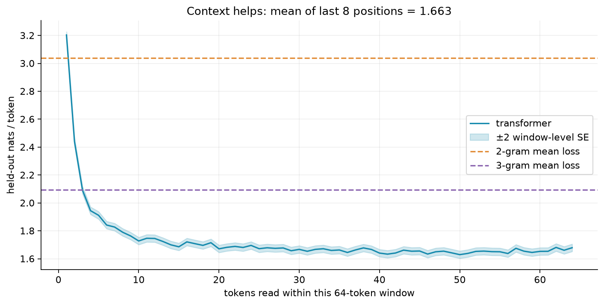

The held-out target stream is cut into consecutive 64-token windows. Each prediction reads its preceding token plus the growing earlier context within that window; no future token is visible. The curve uses **16,859 complete windows** and a band of two window-level standard errors; the final partial window is included in the overall held-out metric, not in the per-position curve.

With one token read, the transformer is worse than the bigram. It passes the trigram after about three tokens and keeps benefiting from context. The mean loss at positions **32–64 is 1.65445**, and at the last eight positions **1.66276**, below the trigram's 2.09434. Every mean at position 32 or later is below that baseline. These window-level error bars are descriptive; adjacent windows need not be statistically independent stories.

### Check all sampling rules against independent exact targets

```bash
.venv/bin/python scripts/language_analysis.py
```

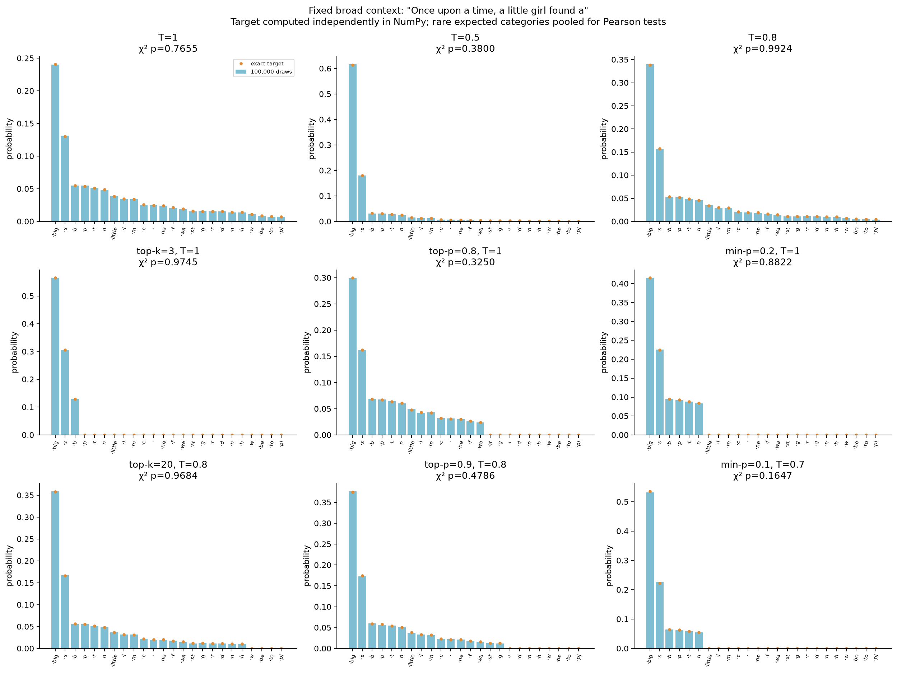

The fixed broad context is **“Once upon a time, a little girl found a”**, with base next-token entropy **2.99156 nats**. For each setting, 100,000 actual JAX inverse-CDF draws are compared with a target computed independently in NumPy. We test both the illustrative settings and the requested generation settings. Temperature is applied before truncation; retained probabilities are renormalized. Top-p **includes the token that crosses the threshold**.

| Rule | Temperature | Pearson p-value |
|---|---:|---:|
| No truncation | 1.0 | 0.765515 |
| No truncation | 0.5 | 0.379976 |
| No truncation | 0.8 | 0.992425 |
| Top-k, k=3 | 1.0 | 0.974500 |
| Top-p, p=0.8 | 1.0 | 0.324956 |
| Min-p, p=0.2 | 1.0 | 0.882241 |
| Top-k, k=20 | 0.8 | 0.968424 |
| Top-p, p=0.9 | 0.8 | 0.478647 |
| Min-p, p=0.1 | 0.7 | 0.164735 |

Every p-value exceeds **0.001**. Rare expected categories are pooled without discarding probability mass; all final expected counts are at least five. The largest JAX-versus-NumPy probability error is about **1.1e-7**. At **temperature 0.0001**, all **100,000** draws return the most likely token. Independent synthetic tests deliberately drop the crossing token and verify that this incorrect top-p implementation is rejected. These tests check sampling correctness, not literary quality or superiority of one decoding rule.

### Stories under the four requested generation rules

The same analysis command generates up to 160 tokens per example, displaying text through the first EOS if one appears. These are the first predetermined seeds, not selected best-of runs.

**Temperature 0.8, seed 1870 — reaches EOS:**

```text
Once upon a time there was a boy named Tim. Tim was hungry. He lived in a big two friends. One day, Tim wanted to play with the ball. One day, Tim felt a big boat night. The boy went to the park and was cold.
Tim saw a small boy who had a big box. He was silly that it was noote. He was scared, he was so happy. They became friends and had a lot of fun with the shark.
```

**Top-k 20 at temperature 0.8, seed 1871 — reaches EOS:**

```text
Once upon a time there was a little girl named Mia. She had a lot of fun. One day, she wanted to go to the park. Her mom sneezed on an idea.
One day she was realized that he was scared. She felt very happy to have her toys with her other.
```

**Top-p 0.9 at temperature 0.8, seed 1872 — truncated at 160 tokens:**

```text
Once upon a time, there was a little girl named Lily. She was happy that she loved to play with her toys. One day, her mommy went to the store with her mom. Sally and her mom said, "Lily, you must be my honey!"
Lily and Tom went to the class and said, "Let's play with the ball. It is my ball."
"It's okay," he says. "I will help."
"Tom goes, Ben. He is very strong and small
```

**Min-p 0.1 at temperature 0.7, seed 1873 — truncated at 160 tokens:**

```text
Once upon a time, there was a little girl named Lily. She lived in a small house with her friends. One day, she saw a big cat named Kitty who was safe. She was very happy. Every day, her friends would talk to her friends with her toys.
One day, Fluffy saw a big cat and shiny piece. She wanted to catch it. She put it on her shoes, but she was too fast. She closed her mom and said, "You're right
```

### Self-consistency: entropy versus surprise

```bash
.venv/bin/python scripts/language_analysis.py
```

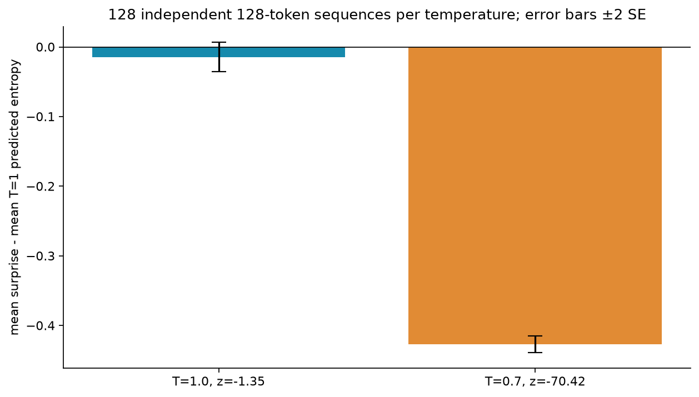

Each temperature generates **128 independent sequences of 128 tokens**. Every drawn token is scored by the **temperature-1 model**, including EOS, with no truncation or EOS exclusion. After the context fills, generation uses the sliding last 64 tokens with position vectors rebased. The standard error is computed across the **128 paired per-sequence mean gaps**, not by pretending all 16,384 tokens are independent.

| Sampling temperature | Mean surprise | Mean T=1 predicted entropy | Mean gap | SE of sequence gap | z-score |
|---|---:|---:|---:|---:|---:|
| 1.0 | 1.60733 | 1.62172 | -0.01440 | 0.01070 | **-1.34551** |
| 0.7 | 1.10656 | 1.53322 | -0.42666 | 0.00606 | **-70.42392** |

At temperature 1, expected surprise equals the model's entropy and the measured difference is within **±4 SE**. Temperature 0.7 samples less surprising tokens under the same model, producing a mismatch beyond **40 SE**. This is the predicted negative control, not failed generation.

### Optional extension: all eight attention heads

```bash
.venv/bin/python scripts/language_analysis.py
```

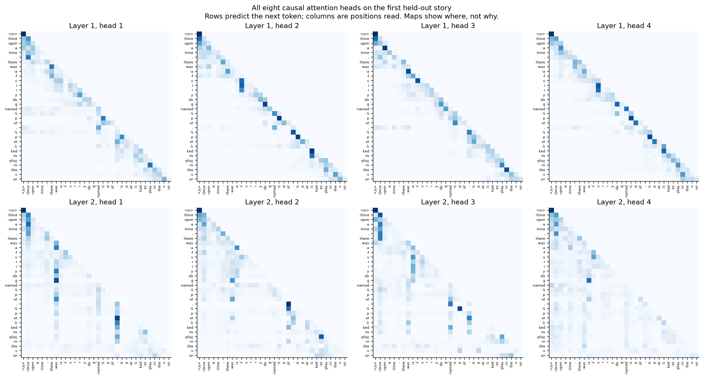

All heads are shown, not a selected attractive pair. Rows are positions predicting the next token; columns are positions read. The first layer is mostly local, while some second-layer heads reach farther back. Future weights are **exactly zero**, and every row sums to one within floating-point precision. The maps show **where** a head reads, not a causal explanation of **what** it computes.

## 8. Part 6 — Refit the scaling law and allocate compute

```bash
.venv/bin/python scripts/scaling.py
```

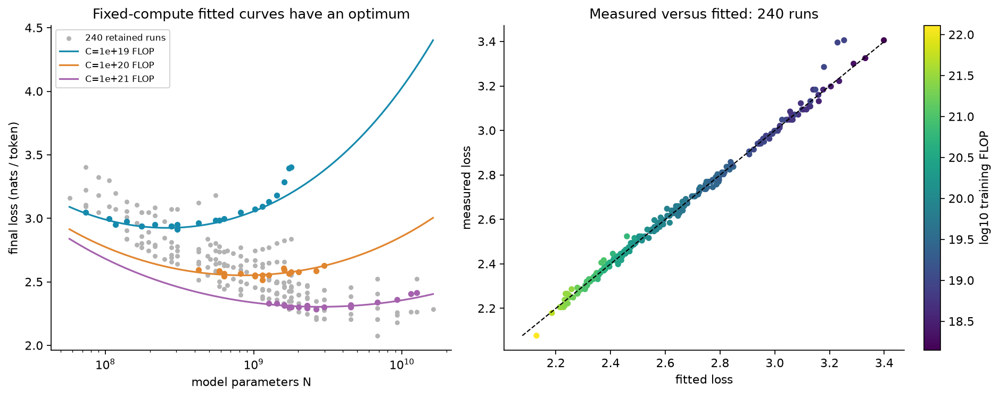

We read **245 published digitized runs**, compute `D=C/(6*N)`, and drop exactly the **five highest-loss rows**, retaining 240. The fitted law is `L=E+A/N**alpha+B/D**beta`. We minimize **Huber loss of the log-loss residual**, δ=0.001, with L-BFGS from a grid of **162 starts**, keeping the best result. All 162 converge. Centering N at 1e9 and D at 1e10 improves conditioning without changing the law; scaling the objective by δ⁻² does not change its minimizer.

Each of **400 bootstrap resamples** draws 240 rows with replacement, starts from the best full-data fit and refits the law. Seed is 1860; all 400 converge. Standard errors below are the sample standard deviations across those refits, not 95% intervals.

| Parameter | Refit | Bootstrap standard error |
|---|---:|---:|
| E | 1.817218 | 0.024643 |
| A | 477.825868 | 118.817983 |
| B | 2143.417369 | 1420.337719 |
| alpha | **0.347310** | 0.014837 |
| beta | **0.367172** | 0.020845 |

Both exponents and the floor meet the specified ranges. The fitted loss follows the measured diagonal. At fixed compute, a model that is too small has insufficient representational capacity; one that is too large sees too few tokens. The three fixed-budget curves therefore have minima.

The parameters printed in the original paper must be tested separately, not substituted for this refit:

```bash
.venv/bin/python scripts/scaling.py
```

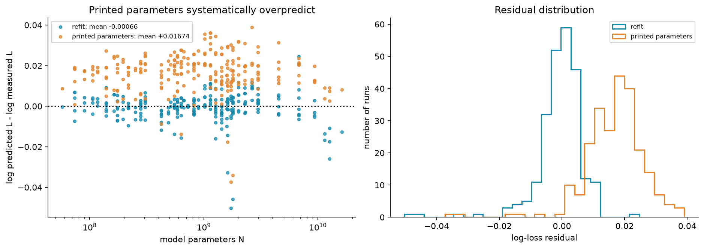

The refit's mean `log(predicted L)-log(measured L)` is **-0.000656**, inside ±0.005. The printed values `(E,A,B,alpha,beta)=(1.69,406.4,410.7,0.34,0.28)` give **+0.016742**, above 0.01: approximately a 1.69% overprediction in geometric mean. A published numerical claim is not automatically reproduced by quoting it.

### Analytic compute-optimal split

```bash
.venv/bin/python scripts/scaling.py
```

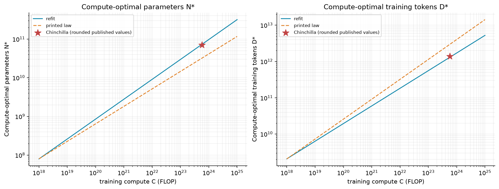

At fixed `C=6*N*D`, substitute `D=C/(6*N)` and set the derivative with respect to log N to zero. The optimum balances the two marginal reductions:

```text
alpha*A/N**alpha = beta*B/D**beta
G = (alpha*A/(beta*B))**(1/(alpha+beta))
N* = G*(C/6)**(beta/(alpha+beta))
D* = (C/6)/N*
```

Thus **N* grows as C^0.51390** and **D* as C^0.48610**, approximately square roots. The complete 141-point compute grid is in `evidence/scaling-metrics.json`; selected budgets are:

| Compute C, FLOP | Optimal parameters N* | Optimal training tokens D* |
|---:|---:|---:|
| 1e18 | 8.0200e7 | 2.0781e9 |
| 1e19 | 2.6186e8 | 6.3646e9 |
| 1e20 | 8.5502e8 | 1.9493e10 |
| 1e21 | 2.7917e9 | 5.9700e10 |
| 1e22 | 9.1154e9 | 1.8284e11 |
| 1e23 | 2.9763e10 | 5.5998e11 |
| 1e24 | 9.7179e10 | 1.7150e12 |
| 1e25 | 3.1730e11 | 5.2526e12 |

At **C=5.76e23 FLOP**, the refit recommends **73.19 billion parameters**, **1.3116 trillion training tokens**, hence **D*/N*=17.9210**. The bootstrap **95% percentile interval is [7.3770,35.4312]**, containing Chinchilla's approximately **20** tokens per parameter. The printed law instead recommends **92.6474 tokens per parameter**. Stars mark the rounded published Chinchilla values, 70 billion and 1.4 trillion; their product differs slightly from the stated budget because those public values are rounded.

The bootstrap quantifies uncertainty conditional on these digitized runs and this fitted law. Extrapolation beyond their compute range is not a guarantee. This law's loss floor belongs to the published models' corpus/tokenizer, **not** our TinyStories 512-token experiment; their numeric losses are not directly comparable.

## 9. Verification, files and demonstration checklist

```bash
.venv/bin/python scripts/check_contracts.py
.venv/bin/python scripts/verify.py --with-artifacts
```

**40 independent contracts** cover tuple-versus-packed n-grams, normalization including unseen contexts, exact aggregation of MLP losses and gradients, strict causal non-leakage, row-normalized attention, all biases and parameter counts, warmup endpoints, independently specified sampling distributions, inverse-CDF boundaries, orthogonal recall, the least-squares own-signal convention, Huber gradients and compute-optimality against direct scalar minimization. Deliberately unnormalized scores, unmasked attention and incorrect top-p threshold handling are negative controls that these checks reject.

The full reproduction passed **288 audit checks**, covering every numerical tolerance above, every figure's direct README embedding, verbatim displayed text samples, all downloaded hashes, complete training histories, held-out losses recomputed from fitted checkpoints, count-table scores, **all 126 per-draw capacity cases**, per-sequence z-scores, all 400 bootstrap vectors and their uncertainty summaries. `evidence/contract-checks.json` and `evidence/acceptance.json` record the results and source fingerprints.

| Requirement | Implementation and evidence |
|---|---|
| Part 1: all 27 word pairs, leave-one-out angles, shuffled control | `scripts/embeddings.py`; embedding-relations figure and JSON |
| Part 2: pinned corpus/tokenizer, story split, all n-grams, tuning k | `scripts/prepare_data.py`, `scripts/ngrams.py`; data provenance, ladder figure and metrics |
| Part 2: explicit normalization and actual 250k Markov sample | Normalization table and pooled chi-square metrics |
| Part 3: every d/M/store, all-key queries, median of three, capacity slopes | `scripts/memory.py`; capacity figure, per-key raw arrays and metrics |
| Part 3: prescribed MLP, held-out bigram comparison | `scripts/language_models.py`, `scripts/train_language.py`; training JSON, model comparison |
| Part 4: all 16 recalled pictures, signal-normalized ratios, β=8 | Picture-recall figure and per-draw picture metrics |
| Part 5: specified biased pre-norm transformer and training budget | Training JSON, model comparison and loss curves |
| Part 5: five common-seed 60-token openings, four generation rules | Full text samples above, raw IDs and settings in language-analysis JSON |
| Part 5: position loss, 100k sampler tests, cold argmax, sequence z-scores | Context, sampler and self-consistency figures and metrics |
| Optional extensions: signed units and every attention head | MLP-unit audit and all-head attention figures/JSON |
| Part 6: robust multistart refit, 400 bootstraps, printed-law residuals | `scripts/scaling.py`; three scaling figures, fit/grid/bootstrap raw records |
| Part 6: analytic optimum across budgets and ratio interval | Compute-optimal figure/table and scaling metrics |

Committed: source, environment/lock files, compact JSON evidence, this README and **all 13 PNG figures**. Ignored: `data/` (corpus, tokenizer, pretrained embedding download and input CSV), `artifacts/` (count tables, checkpoints, raw measurements), `.venv/` and caches. Raw artifacts occupy about 176 MB and downloads about 51 MB in this run. There are no corpus excerpts from the download committed as a separate dataset; the text samples above are model-generated outputs. No downloaded weights enter Git.

The sheet asks to push source and evidence and **show the completed work at the start of Week 9**. It explicitly states that there is no separate formal submission. This repository prepares that demonstration; it does not claim the classroom presentation has already happened.
