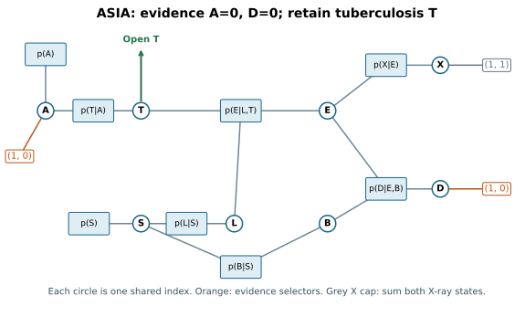
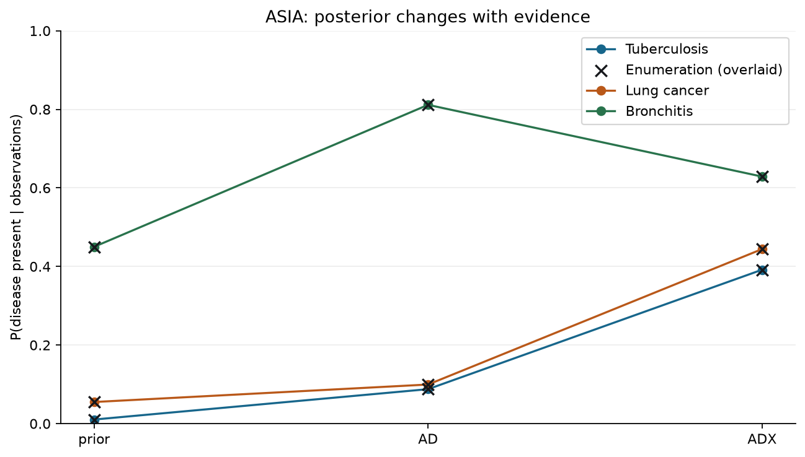
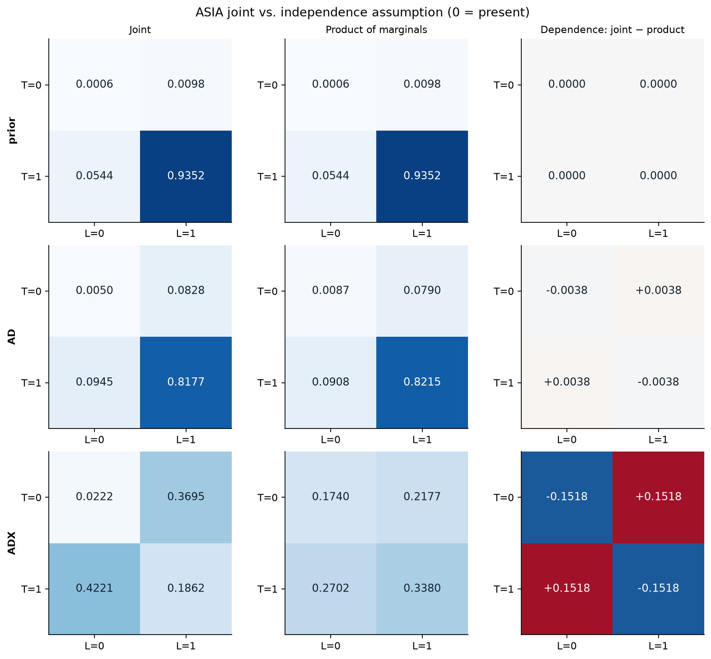
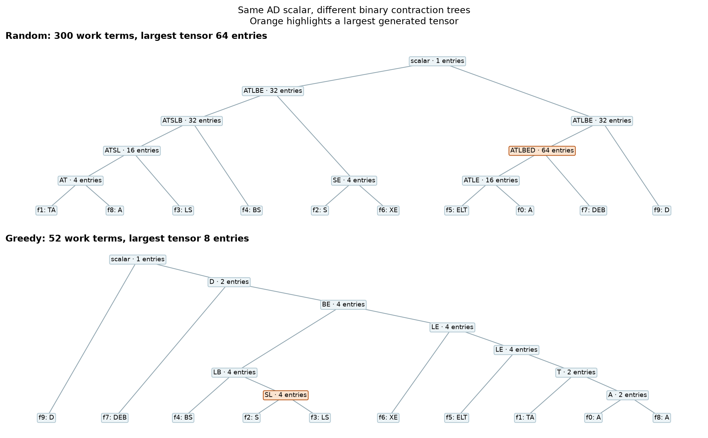
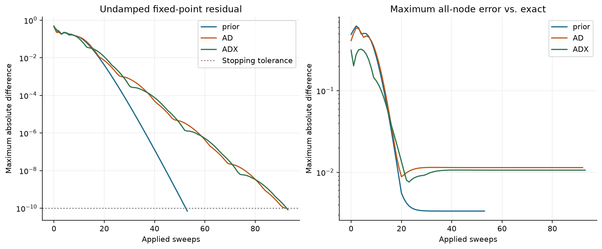
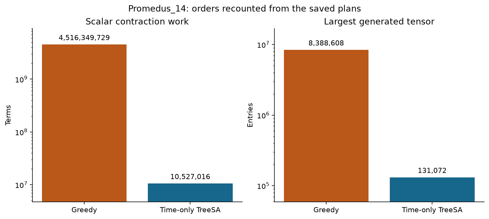
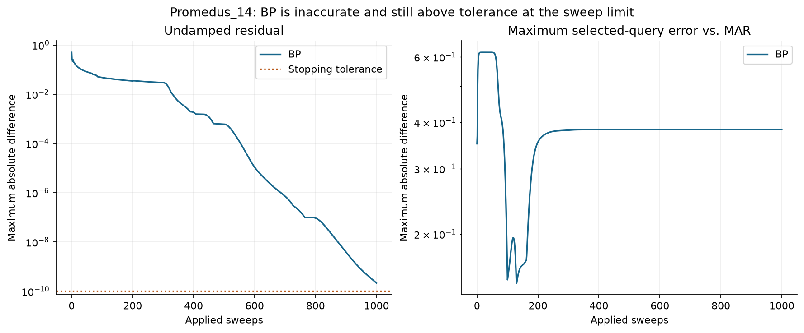

# Week 9 — Probabilistic inference by tensor contraction

Boyuan's hands-on work: exact ASIA inference and Ising checks, contraction-order search and replay, loopy belief propagation, and the Promedus_14 benchmark. The Rust implementation uses float64 and the Tenferro tensor, native CPU and einsum crates, with neither CUDA nor autodiff enabled. All seven figures are embedded below.

## Reproduce

From the repository root in Linux/WSL, with `rustup`, `uv` and `curl` available:

```bash
cd week9
rustup toolchain install 1.96.0 --profile minimal
uv sync --frozen
bash scripts/run.sh
.venv/bin/python scripts/evidence.py
.venv/bin/python scripts/audit.py
```

The run script downloads the pinned inputs if missing, builds and tests the locked project, and keeps full raw results in `artifacts/` and `runs/`. The evidence script independently verifies the results in NumPy, recounts the saved plans, and renders the figures. The audit script checks the committed evidence without needing the raw runs. To put the binary on PATH instead, use `cargo +1.96.0 install --locked --path .`.

- Environment: Ubuntu/WSL2, Rust 1.96.0, Tenferro 0.11.0, omeco 0.2.6; plotting with Python 3.14.4, NumPy 2.5.3 and Matplotlib 3.11.2. Details are in [environment.json](evidence/environment.json), with dependencies locked in Cargo.lock and uv.lock. Contraction uses a serial CPU engine; omeco's parallel trials use 8 Rayon threads by default.
- Inputs: [pinned ASIA UAI file](https://raw.githubusercontent.com/TensorBFS/TensorInference.jl/935ed86f8e473f523cac9461c45a1f470e74f0f9/examples/asia-network/model.uai) and [pinned UAI 2014 Promedus_14 mirror](https://github.com/mroavi/uai-2014-inference-competition/tree/22005844423f5bca62798548df808cc418fc0d7d/uai2014). The precise model, evidence, PR and MAR URLs are in `scripts/fetch.sh`; SHA-256 digests are in [input-hashes.json](evidence/input-hashes.json).
- [infer.design.toml](infer.design.toml) describes the CLI and outputs. Downloads, build products, and full raw traces are ignored by Git; evidence figures, scalar plans, independently recounted costs and compact traces are committed.

## 1. Exact inference on ASIA

```bash
for name in prior AD ADX; do
  target/release/infer --model asia.uai --evidence "$name" --out "artifacts/$name"
done
.venv/bin/python scripts/evidence.py
```



Each factor keeps its UAI axis order, with the last listed variable varying fastest. In particular the asymmetric `(T,A)` table is `[[0.05,0.01],[0.95,0.99]]`. The eight IDs are A,T,S,L,B,E,X,D; zero means present/yes/positive. In AD, the selectors for A and D are `(1,0)`. All three appearances of S share one index. The open query gives weights for each T state; the closed contraction gives the mass used to normalize them. This is a teaching network, not a clinical diagnostic tool.



| Case | Evidence mass | P(T=0) | P(L=0) | P(B=0) |
|---|---:|---:|---:|---:|
| prior | 1 | 0.010400 | 0.055000 | 0.450000 |
| AD | 0.004501375 | 0.087751 | 0.099525 | 0.811402 |
| ADX | 0.00098822675 | 0.391712 | 0.444271 | 0.628822 |

Each run records all eight marginals and the (T,L) joint from both methods. Across the three runs, maximum marginal/joint discrepancy from Rust enumeration is **3.33e-16** and the largest relative mass error is **3.85e-16**, both below 1e-10. A separate NumPy full-cube calculation checks the parser layout, weights and probabilities.



Adding a positive X-ray increases both TB and lung-cancer probabilities while reducing bronchitis relative to AD. In ADX, the joint probability of both T=0 and L=0 is **0.022214**, while the independence product is **0.174026**. The signed difference, about **−0.1518**, is dependence under conditioning, not a numerical error.

The same inference binary computes the matrix and Ising examples. NumPy direct sums independently check the matrix entries and trace, and enumerating all eight spin assignments checks the partition function:

| Check | Tenferro result | Independent result | Absolute discrepancy |
|---|---|---|---:|
| AB, with A=[[1,2],[3,4]], B=[[2,0],[1,2]] | [[4,4],[10,8]] | [[4,4],[10,8]] | 0 |
| tr(AB) | 12 | 12 | 0 |
| Three-spin ring, beta=0.5, J=1, zero field | 12.602562098951932 | 12.602562098951930 | 1.78e-15 |

All pass the 1e-12 tolerance. Full precision, including the independent results, is in [asia.json](evidence/asia.json).

## 2. Contraction orders: the same AD answer at different costs

```bash
infer=target/release/infer
"$infer" --model asia.uai --evidence AD --order random --seed 42 --out runs/random
"$infer" --model asia.uai --evidence AD --order greedy --out runs/greedy
"$infer" --model asia.uai --evidence AD --analyze runs/random/order.json --out runs/analysis
"$infer" --model asia.uai --evidence AD --plan runs/greedy/order.json --out runs/replay
.venv/bin/python scripts/evidence.py
```



The recorded seed-42 random plan needs **300** work terms and peaks at **64 entries** in its `A,T,L,B,E,D` intermediate. Greedy needs **52** terms, peaks at **8** entries including the inputs, and generates intermediates of at most **4** entries (including `S,L`). Both yield evidence mass **0.004501375** within 1e-10 relative error. The difference is **5.77×** in work and **8×** in maximum tensor size, not a timing claim.

The analyzer recomputes the cost from labels without evaluating tensor values. A separate Python recount rebuilds leaf subsets and verifies every retained axis and every work term. The analyzed random costs match the executed plan, and replay reproduces the same greedy costs and probability. A subset dynamic program exhaustively minimizes work over binary trees: **44, 50, 52** for prior, AD and ADX respectively; the recorded greedy AD plan is close to, but not at, the minimum. Greedy tie-breaking can give a different valid plan in a fresh search. Use [the saved greedy plan](evidence/ad-greedy-plan.json) or [the saved random plan](evidence/ad-random-plan.json) to replay this exact comparison; [orders.json](evidence/orders.json) records the independent recount.

## 3. ASIA loopy belief propagation

```bash
for name in prior AD ADX; do
  target/release/infer --model asia.uai --evidence "$name" --method bp \
    --damping 0.5 --tolerance 1e-10 --max-sweeps 1000 --out "artifacts/bp-$name"
done
.venv/bin/python scripts/evidence.py
```



Observations slice factor axes; observed variables are returned as point masses and smoking stays unobserved. Messages start uniformly. Both directions use the old state to compute a synchronous, normalized proposal, omitting the recipient. Damping applies half the proposal. Residual is `max|F(m)-m|` at the same state as the recorded beliefs, **not** the size of the damped step.

| Case | Applied sweeps | Final undamped residual | Maximum absolute marginal error | Update work |
|---|---:|---:|---:|---:|
| prior | 53 | 7.03e-11 | 0.003340 | 13,608 |
| AD | 92 | 9.94e-11 | 0.011407 | 16,368 |
| ADX | 93 | 8.23e-11 | 0.010612 | 15,228 |

All three residuals are below tolerance, but the ADX error remains about **1.06 percentage points**. A separate nonuniform factor-tree test matches enumeration; the error on ASIA is not evidence that the message updates are implemented incorrectly. Each proposal counts the scalar multiplications/accumulations in the variable-to-factor and factor-to-variable updates, excluding normalization, damping and belief reporting. A proposal is evaluated at sweep zero and at the returned state, so cumulative work is `(applied_sweeps + 1) × work_per_proposal`.

## 4. Promedus_14: exact PR/MAR and an unconverged BP run

```bash
infer=target/release/infer
export RAYON_NUM_THREADS=8
args=(--model promedus/Promedus_14.uai --evidence promedus \
      --observations promedus/Promedus_14.uai.evid --queries 59,102,139)
"$infer" "${args[@]}" --order greedy --out artifacts/promedus-greedy
"$infer" "${args[@]}" --order treesa --out artifacts/promedus-treesa
.venv/bin/python scripts/evidence.py
```



The input has **414 binary variables and nine observations**. Exact inference slices observed axes but preserves the resulting scalar factor. To avoid losing absolute scale, each nonzero tensor is divided by its maximum and its removed natural-log multiplier is carried through the tree. The scalar yields `log10(Z_evidence)`; the three node queries reopen one index at a time on the same saved tree and divide their restored weights by the scalar. The evidence partition sum here is **not** a normalized evidence probability.

TreeSA uses omeco's seeded trials, `SmallRng(42 + trial_index)` for trials 0–9, greedy initialization, 300 beta levels `0.01 + 0.05*i`, 50 iterations per level and weights (time=1, space=0, read/write=0). The [greedy plan](evidence/promedus-greedy-plan.json) and [TreeSA plan](evidence/promedus-treesa-plan.json) include the realized pair orders and settings. Heuristic tie-breaking can vary, and neither plan certifies optimality. Saved scalar plans are directly replayable with `--plan`; each raw run also saves the three adapted query plans and their recounted costs.

| Order | Scalar work terms | Largest generated tensor | Search time | Scalar + three exact queries |
|---|---:|---:|---:|---:|
| Greedy | 4,516,349,729 | 8,388,608 | 0.0084 s | 1.286 s |
| Time-only TreeSA | 10,527,016 | 131,072 | 2.474 s | 0.061 s |

TreeSA reduces scalar work by about **429×** and peak entries by **64×** in this recorded run. Its order search took longer than the contraction savings for a single run on this machine. Cost metrics are shape-based work terms, not measured FLOPs or a promise of wall-clock speedup. Per-query costs and timings are recorded separately in [promedus.json](evidence/promedus.json).

The exact orders give **log10 Z = −7.806746304582435**; the published PR value is **−7.80675** (absolute difference **3.70e-6**, within 1e-4). Both exact plans agree within 1e-10 for PR and both states of each MAR query. The largest absolute exact-vs-published MAR difference is **4.33e-7**, within 1e-5.

| ID | Exact [state 0, state 1] | Published MAR | BP [state 0, state 1] |
|---|---|---|---|
| 59 | [0.802411742, 0.197588258] | [0.802412, 0.197588] | [0.999914382, 0.000085618] |
| 102 | [0.850246568, 0.149753432] | [0.850247, 0.149753] | [0.999749239, 0.000250761] |
| 139 | [0.382477982, 0.617522018] | [0.382478, 0.617522] | [0.000125064, 0.999874936] |

```bash
target/release/infer "${args[@]}" --method bp --damping 0.5 --tolerance 1e-10 \
  --max-sweeps 1000 --out artifacts/promedus-bp
.venv/bin/python scripts/evidence.py
```



After **1,000 sweeps**, BP is **unconverged** (undamped residual **2.1163e-10**) and **inaccurate** (maximum selected-query error **0.382353** vs. published MAR). The BP run took about **0.116 s** inside the solver, recording **22,446,424** update operations by the convention above. BP reports beliefs for all 414 nodes; the exact timings cover the scalar and only three query marginals, so these are different workloads. No BP partition-sum estimate is used as an exact PR result.

The three Rust tests and independent NumPy, plan-replay and PR/MAR checks are the verification evidence. The learning sheet asks to show the hands-on work at the start of Week 10; tutorial answers and sketches are not deliverables.
